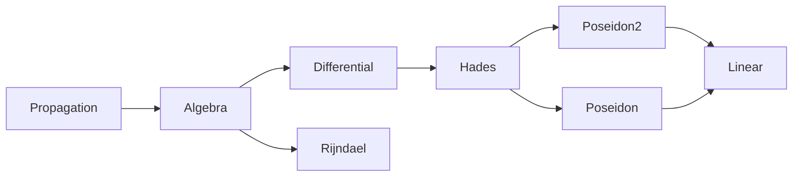

# WideTrail

*Machine-checked bounds, in Lean 4, on differential and linear trails of AES and of the
Poseidon2 and Poseidon permutations deployed by SP1, Pico, OpenVM, Aztec, Noir and Starknet.*

[](https://github.com/4waan/Wide-Trail-formal-verification/actions/workflows/ci.yml)
[](lean-toolchain)
[](lakefile.toml)
[](scripts/AuditAxioms.lean)
[](LICENSE)

## What this is

WideTrail proves, for the exact permutation each system ships (field, width, round numbers,
matrices and round constants, pinned to a source: a tag, a commit or a crate checksum), that
every pair of distinct inputs drives a nonzero difference through at least a stated number of
S-boxes: 35 for SP1's and Pico's KoalaBear Poseidon2, 32 for SP1's and OpenVM's BabyBear, 43
and 44 for the two BN254 instances, and 57 for Starknet's Poseidon. For AES it proves Daemen
and Rijmen's wide-trail bound with the real `MixColumns`: at least 25 active S-boxes in any four
consecutive rounds. From these counts it bounds the probability of one differential trail (one
trail, independent uniform round keys) and, for AES, the correlation of one linear trail.

**Why it matters.** Designers choose round numbers partly from counts like these, made by hand
or with trail-search tools. Here each count is a theorem about an executable model that
reproduces known-answer vectors from the upstream tests (for SP1's two width-16 instances, only
with the tests' own constants; see the notes under the table). So the count is tied to the code
you run, and not only to a paper's parameter set. The partial-round counts of KoalaBear, the
BN254 instances and Starknet come from finite certificates that the kernel checks, and two of
the totals (43 and 57) are attained by a trail in the trail model the proofs use. If your system hashes with one of these permutations, the
table below says what is proved about it, and its linked section says which code, parameters
and test vectors the proof covers.

**What it is not.** It is not a security proof. It says nothing about algebraic attacks, about
collisions or preimages, or about whether the Rust, C++, Cairo or circuit code agrees with the
model on every input. See [What is proved and what is not](#what-is-proved-and-what-is-not).

Lean's kernel, a small proof checker, checks every proof. No proof step is left open (Lean's
`sorry`), and none relies on compiled code (`native_decide`). The only axioms are Lean's three
standard ones: `propext`, `Classical.choice` and `Quot.sound`.

- **zk engineers:** find your system in the
  [Poseidon2 and Poseidon table](#deployed-poseidon2-and-poseidon-permutations), then read
  [What is proved and what is not](#what-is-proved-and-what-is-not).
- **Cryptographers:** [Results at a glance](#results-at-a-glance), then
  [How it works](#how-it-works) and the [mechanics documents](#documentation).
- **Auditors:** [What is proved and what is not](#what-is-proved-and-what-is-not), the
  [Quick start](#quick-start) audit commands, and
  [Boundary of the certificate](PRODUCTION_CERTIFICATE.md#boundary-of-the-certificate).
- **Lean users:** [Use it in your own Lean project](#use-it-in-your-own-lean-project) and the
  [library map](#library-map).

Terms: [Glossary](docs/GLOSSARY.md).

## Results at a glance

### Deployed Poseidon2 and Poseidon permutations

HADES is the round structure of Poseidon and Poseidon2: full rounds, which apply the S-box to
every coordinate, around partial rounds, which apply it to one coordinate.

**Charged S-boxes:** every pair of distinct inputs incurs at least this many S-box applications
on a nonzero difference. **Trail exponent `e`:** every trail with a nonzero input difference
has probability at most `2^-e` (one trail, independent uniform round keys: an additional
independent uniform key per round). `e` is the largest integer with `2^e · u^A ≤ p^A`, for `A`
charged S-boxes of differential uniformity `u` (the most inputs that one nonzero input
difference sends to one output difference) over a field of size `p`. It keeps the ratio
`p / u` per charged S-box exact, and does not round each S-box down to whole bits.

> **These are not security levels.** `e` bounds the probability of one differential trail when
> each round constant is replaced by an independent uniform key. It can exceed the state size
> (KoalaBear: a 496-bit state, `e = 1049`). That is expected for a bound on one trail. It is
> not a bound for the permutation with its fixed constants, and not a bound on a differential.

| Permutation | Field | Width | Rounds (full + partial + full) | S-box | Charged S-boxes, at least | Trail exponent `e` |
|---|---|---|---|---|---|---|
| [SP1 6.10.0, main proof system](PRODUCTION_CERTIFICATE.md#sp1-width-sixteen-instances) | KoalaBear, `2^31 - 2^24 + 1` | 16 | 4 + 20 + 4 | `x^3` | 35 | 1049 |
| [SP1 5.2.4, main proof system](PRODUCTION_CERTIFICATE.md#sp1-width-sixteen-instances) | BabyBear, `2^31 - 2^27 + 1` | 16 | 4 + 13 + 4 | `x^7` | 32 | 906 |
| [Pico v3.2.0](PRODUCTION_CERTIFICATE.md#pico-and-openvm-width-sixteen-instances) | KoalaBear | 16 | 4 + 20 + 4 | `x^3` | 35 | 1049 |
| [OpenVM v2.1.0](PRODUCTION_CERTIFICATE.md#pico-and-openvm-width-sixteen-instances) | BabyBear | 16 | 4 + 13 + 4 | `x^7` | 32 | 906 |
| [HorizenLabs reference BN254; SP1 6.10.0 outer recursion and wrap](PRODUCTION_CERTIFICATE.md#pinned-bn254-instance) | BN254 scalar field | 3 | 4 + 56 + 4 | `x^5` | 43 | 10818 |
| [Aztec barretenberg (aztec-packages v1.0.0, v6.1.0); Noir v1.0.0](PRODUCTION_CERTIFICATE.md#aztec-and-noir-bn254-width-four-instance) | BN254 scalar field | 4 | 4 + 56 + 4 | `x^5` | 44 | 11070 |
| [Starknet's Poseidon (cairo-lang v0.14.0.1)](PRODUCTION_CERTIFICATE.md#starknets-poseidon-hades-instance) | STARK field, `2^251 + 17 · 2^192 + 1` | 3 | 4 + 83 + 4 | `x^3` | 57 | 14250 |

- **Known-answer vectors.** Every row reproduces upstream test vectors; each instance's section
  lists them.
  - SP1: the upstream `p3-koala-bear` and `p3-baby-bear` tests, with the tests' own constants.
    No published vector exists for SP1's pinned constants; regression values from an outside
    model are checked as well.
  - Pico: the Plonky3 fork's `test_default_koalabear_poseidon2_width_16`, deployed constants.
  - OpenVM: Plonky3 v0.8.0's `test_default_babybear_poseidon2_width_16`, deployed constants.
  - HorizenLabs BN254: upstream `[0, 1, 2]`; SP1's gnark test, `(0, 0, 0)`.
  - Aztec and Noir: seven inputs from barretenberg, bb.js and Noir.
  - Starknet: three inputs, from pathfinder and CryptoExperts, starknet-types-core and
    lambdaworks, and the Cairo corelib.
- **Same permutation as.** OpenVM's is `default_babybear_poseidon2_16()` of `p3-baby-bear`
  0.4.3. Pico's is `default_koalabear_poseidon2_16()` of `p3-koala-bear` 0.5.4 in Brevis's
  Plonky3 fork. Starknet's is also the permutation of the Cairo corelib, lambdaworks,
  starknet-types-core, cairo-vm and pathfinder.
- **Tightness in the trail model.** 43 (HorizenLabs BN254) and 57 (Starknet) are attained by a
  trail in the `IsTrail` model (`activity_attained`), so no argument that uses only that model
  proves more. For Aztec and Noir a trail in the model charges 47. For KoalaBear, 3 is the
  largest bound for the 20 partial rounds (`middle_bound_not_four`). For BabyBear all 32 come
  from the 8 full rounds: thirteen partial rounds are fewer than the width 16, and exactly 3
  dimensions of differences cross all of them without activating an S-box
  (`finrank_partial_inactive`). None of the counts is claimed to be attained by an input pair.
- **Not listed?** The counts hold for every round-constant table (the `_general` forms), but
  they depend on the field, the width, the round numbers and both linear layers. An instance
  that differs in any of these is not covered. Open an issue with the pinned source;
  [Adding a deployed instance](CONTRIBUTING.md#adding-a-deployed-instance) lists what a new
  instance needs.

For KoalaBear, both BN254 permutations and Starknet, the partial rounds are charged by
certificates that the kernel checks. The earlier window counts (33 for KoalaBear, 34 for both
BN254 permutations, 43 for Starknet) and the whole-bit exponents are in
[Counting more partial rounds](PRODUCTION_CERTIFICATE.md#counting-more-partial-rounds); the
two-round differential exponents are in each instance's section.

<details>
<summary>Lean theorem names</summary>

`activity_middle` and `independent_key_probability_middle_sharp` in `Poseidon2.KoalaBear`,
`Poseidon2.PicoKoalaBear`, `Poseidon2.BN254`, `Poseidon2.AztecBN254` and `Poseidon.Starknet`;
`activity` and `independent_key_probability_sharp` in `Poseidon2.BabyBear` and
`Poseidon2.OpenVMBabyBear`. Tightness: `activity_attained` in
`Poseidon2.BN254.MiddleSharpChecks`, `Poseidon2.AztecBN254.MiddleChecks` and
`Poseidon.Starknet.MiddleChecks`;
`middle_bound_not_four` in `Poseidon2.KoalaBear.MiddleChecks` and
`Poseidon2.PicoKoalaBear.MiddleChecks`; `finrank_partial_inactive` in `Poseidon2.BabyBear` and
`Poseidon2.OpenVMBabyBear`.

</details>

### AES and Rijndael

| Rounds | Active S-boxes, at least | Differential trail probability, at most (one trail, independent uniform round keys) | Linear trail correlation, at most in absolute value (one trail, [trace pairing](docs/GLOSSARY.md#pairing-trace-pairing-and-bit-pairing)) |
|---|---|---|---|
| 4 (any four consecutive rounds) | 25 | `2^-150` | `2^-75` |
| 10 (AES-128) | 55 | `2^-330` | `2^-165` |
| 12 (AES-192) | 75 | `2^-450` | `2^-225` |
| 14 (AES-256) | 80 | `2^-480` | `2^-240` |

- For every nonzero input difference or mask. The activity counts hold for any S-box layer that
  preserves supports (`PreserveSupport`: the output difference is nonzero exactly where the
  input difference is), which every bricklayer of bijective S-boxes does.
- The real `MixColumns` matrix is proved MDS (every square submatrix is nonsingular), so its
  branch number (the least number of active bytes in a nonzero input and its output together)
  is 5 (`aesMatrix_isMDS`).
- The probability bounds use the AES S-box, whose differential uniformity is 4, attained: no
  nonzero input difference reaches one output difference for more than 4 of the 256 inputs
  (`AES.sbox_uniform`, `AES.sbox_uniformity_witness`). They average over independent round
  keys, not the AES key schedule.
- Rijndael-192 and Rijndael-256: at least 75 and 80 active S-boxes over 12 and 14 rounds, with
  the real `MixColumns` and no hypothesis on it
  ([details](docs/LAYERS.md#rijndael-layer)).

<details>
<summary>Lean theorem names</summary>

`aes_four_round_concrete`, `aes128_ten_round_concrete`, `aes192_twelve_round_concrete`,
`aes256_fourteen_round_concrete`; `AES.four_round_probability` to
`AES.fourteen_round_probability`; `AES.four_round_correlation` to
`AES.fourteen_round_correlation`; `Rijndael.rijndael192_twelve_round_concrete`,
`Rijndael.rijndael256_fourteen_round_concrete`. Details:
[AES S-box](PRODUCTION_CERTIFICATE.md#aes-s-box) and
[AES linear trails and hull](PRODUCTION_CERTIFICATE.md#aes-linear-trails-and-hull).

</details>

### Linear cryptanalysis

| Target | Proved | Lean |
|---|---|---|
| AES S-box | Every correlation at a nonzero input mask is at most `2^-3` in absolute value: every Walsh value at a nonzero input mask is at most 32 in absolute value, and 32 is attained | `AES.sbox_isLinearityBound`, `AES.sbox_isLinearityBound_iff` |
| AES trails, 4, 10, 12 and 14 rounds | Correlation at most `2^-75`, `2^-165`, `2^-225` and `2^-240` in absolute value, for every trail with a nonzero input mask (table above) | `AES.four_round_correlation` to `AES.fourteen_round_correlation` |
| AES hull, any `R ≥ 2` rounds | Expected linear probability (the squared correlation, averaged over an additional independent uniform key per round) at most `2^-24` for every nonzero input mask | `AES.two_round_elp`, `AES.rounds_elp` |
| Poseidon2 and Poseidon instances | Every linear trail with a nonzero input mask and a nonzero correlation charges at least the differential counts: 35 (SP1 and Pico KoalaBear), 32 (SP1 and OpenVM BabyBear), 43 (HorizenLabs BN254), 44 (Aztec and Noir), 57 (Starknet). This holds for every separating pairing and character (proved for the standard character in `Linear/Field.lean`) | `linear_activity_middle` in the instance namespaces above; `linear_activity` for the two BabyBear instances |

- AES is treated under the trace pairing of `GF(2⁸)`, not under bit masks, so the designers'
  four-round bound for bit masks is not proved.
- A trail bound bounds one summand of the fixed-key correlation, not the correlation of AES for
  a fixed key.
- For Poseidon2 the count is over the rounds after the initial external layer. For the
  prime-field instances no bound on a Walsh value of `x ↦ x^d` (such as the Weil bound) is
  proved, so no linear exponent is stated.
- Details:
  [AES linear trails and hull](PRODUCTION_CERTIFICATE.md#aes-linear-trails-and-hull),
  [Linear activity of the HADES instances](PRODUCTION_CERTIFICATE.md#linear-activity-of-the-hades-instances)
  and [MECHANICS_LINEAR.md](MECHANICS_LINEAR.md).

## What is proved and what is not

**Checked by Lean's kernel.** Every theorem of the libraries `WideTrail` and `WideTrailHeavy`.
Two audits, run in CI, check every project declaration by its defining module
([`scripts/AuditAxioms.lean`](scripts/AuditAxioms.lean),
[`scripts/AuditAxiomsHeavy.lean`](scripts/AuditAxiomsHeavy.lean)). They allow only `propext`,
`Classical.choice` and `Quot.sound`: no `sorry`, no `native_decide`, no `bv_decide` fallback
axiom. Finite checks run in the kernel, by `decide` or `decide +kernel`.

**What the numbers mean.**

- Activity counts are lower bounds. They are not claimed to be attained by an input pair. For
  HorizenLabs BN254 (43) and Starknet (57) some trail in the `IsTrail` model attains the total
  (`activity_attained`).
- Probability exponents bound one trail, with independent uniform round keys (an additional
  independent uniform key per round). They do not bound the permutation with its fixed
  constants, or any one fixed key.
- Differential bounds, the sum over all trails, charge only the first two full rounds, in the
  same key-averaged model.
- Linear results: for AES, under the trace pairing only; for the prime-field instances,
  activity counts only.

**Checked outside Lean.**

- The constants, diagonals and matrices in Lean were compared with the pinned sources outside
  Lean; the comparison is not in this repository. Each instance's section gives its pins: tags
  and commits, crate archives with their SHA-256, and the SHA-256 of some files read. Where a
  section says that the SHA-256 of a file read was recorded outside Lean (Pico, Aztec and Noir,
  Starknet), that hash is not in this repository. For Pico, the tag is not resolved to a commit.
- That the model reads the deployed code as the code runs: Lean reproduces the upstream
  known-answer vectors and rejects negative controls, but a vector checks one input, not every
  input.
- An independent Python model
  ([Independent implementation checks](PRODUCTION_CERTIFICATE.md#independent-implementation-checks)),
  for AES and the BN254 width-three instance, is outside the repository. Its author is the
  author of the proofs.
- Certificate generators (Lucas certificates, window relations, automata) run outside Lean;
  their output is checked in Lean, so they need not be trusted.

**Not proved.** A security level against every attack; algebraic attacks; subspace trails in
general; collision or preimage resistance; sponge indifferentiability; equivalence with the
Rust, C++, Python or Cairo code, with machine code, or with a circuit or AIR; zkVM soundness;
the AES key schedule; the Poseidon designers' criterion that every differential has
probability at most `p^(-t)`. The full list is in
[Boundary of the certificate](PRODUCTION_CERTIFICATE.md#boundary-of-the-certificate).

**To audit one claim.**

1. Find its theorem in the instance's Certified claims, in
   [PRODUCTION_CERTIFICATE.md](PRODUCTION_CERTIFICATE.md).
2. Read the statement and the definitions it uses, for example `Hades.scheduledWeight`,
   `Hades.differenceTrace` and the instance's `rounds`.
3. Run `#print axioms` on it, as in [Check one result](#quick-start).
4. Compare the constants in the instance's Lean files with the pinned source, using the pins
   in the instance's section.

## Quick start

Install elan, Lean's installer. It also installs Lake, Lean's build tool:

```bash
curl https://raw.githubusercontent.com/leanprover/elan/master/elan-init.sh -sSf | sh
```

elan installs the Lean version pinned in [`lean-toolchain`](lean-toolchain) (`v4.33.1`). You
also need git, and Python 3 for the import check. Lake fetches Mathlib `v4.33.1`, pinned in
[`lakefile.toml`](lakefile.toml). Expect about 8 GB of disk, mostly Mathlib's prebuilt files
(`.lake/packages` measured 7.6 GB).

```bash
git clone https://github.com/4waan/Wide-Trail-formal-verification.git
cd Wide-Trail-formal-verification
lake exe cache get                         # prebuilt Mathlib files, instead of compiling Mathlib
lake build                                 # the default library WideTrail
lake env lean scripts/AuditAxioms.lean     # only propext, Classical.choice, Quot.sound
python3 scripts/check_imports.py           # every module is reachable from a library root
```

A successful `lake build` means every theorem in the default library has been checked by
Lean's kernel. No module of the default library has a recorded peak above about 3.4 GB of
memory; these measurements predate the Rijndael layer, whose modules have none
([details](docs/BUILDING.md#the-heavy-library)). Lake runs one Lean process per core, so the
peak of the default build grows with the number of cores. CI's GitHub-hosted runner, with 16 GB
of memory, builds both libraries.

**Check one result.** Build one module and its imports, then ask Lean for the axioms of one
theorem:

```bash
lake build WideTrail.Poseidon.StarknetMiddle
printf 'import WideTrail.Poseidon.StarknetMiddle\n#print axioms Poseidon.Starknet.activity_middle\n' > /tmp/Check.lean
lake env lean /tmp/Check.lean
```

**The heavy library.** `WideTrailHeavy` adds three check modules that evaluate whole
width-16 Poseidon2 permutations in the kernel, and `Linear/Field.lean`. Each check module
needs 7 to 12 GB of memory. Lake builds independent modules in parallel, so build them one at
a time:

```bash
lake build WideTrail.Poseidon2.Checks.KoalaBear   # about 12 GB
lake build WideTrail.Poseidon2.Checks.BabyBear    # about 7 GB
lake build WideTrail.Poseidon2.Checks.Plonky3     # about 7 GB
lake build WideTrailHeavy
lake env lean scripts/AuditAxiomsHeavy.lean      # the audit with these checks included
```

These modules add the round-by-round traces of SP1's upstream tests, the regression values for
SP1's pinned constants, further exactness checks of SP1's two instances, and checks of the
generic width-16 model on small fields. `Linear/Field.lean` discharges the separation
hypothesis of the linear activity theorems for the standard character. The known-answer
vectors listed under the table above are already proved by `lake build` (for SP1, in
`Poseidon2/Checks/Plonky3KAT.lean`).

Memory figures, CI, releases and troubleshooting: [docs/BUILDING.md](docs/BUILDING.md).

## Use it in your own Lean project

Your project must use the same toolchain: put `leanprover/lean4:v4.33.1` in its
`lean-toolchain`. Then require WideTrail in `lakefile.toml`:

```toml
[[require]]
name = "WideTrail"
git = "https://github.com/4waan/Wide-Trail-formal-verification.git"
rev = "main"    # better: a commit hash, or a release tag once one is published
```

or, in `lakefile.lean`:

```lean
require WideTrail from git
  "https://github.com/4waan/Wide-Trail-formal-verification.git" @ "main"
```

Lake fetches Mathlib `v4.33.1` with it; if your project also requires Mathlib, require the
same version. Run `lake update WideTrail`, then `lake exe cache get` for the prebuilt Mathlib
files, then `lake build`. WideTrail itself publishes no prebuilt files, so Lake compiles the
modules you import.

```lean
import WideTrail

-- 55 active S-boxes over the ten rounds of AES-128, for every nonzero input difference.
#check @aes128_ten_round_concrete

-- Starknet's Poseidon: every pair of distinct inputs incurs at least 57 charged S-boxes.
open Poseidon.Starknet in
example {x y : State} (hxy : x ≠ y) :
    57 ≤ Hades.scheduledWeight rounds (Hades.differenceTrace rounds x y) 0 91 :=
  activity_middle hxy

#print axioms Poseidon.Starknet.activity_middle
-- 'Poseidon.Starknet.activity_middle' depends on axioms: [propext, Classical.choice, Quot.sound]
```

`import WideTrail` loads the whole default library. To compile less, import only the module
you need, for example `import WideTrail.Poseidon.StarknetMiddle`. Each layer can also be
imported whole, for example `import WideTrail.Hades`. The [library map](#library-map) lists
the layers.

## How it works

An AES-like round has three steps: an S-box layer γ, a shuffle π and a mixing layer θ
([diagram](docs/HOW_IT_WORKS.md#the-shape-of-a-round)). HADES partial rounds apply the S-box to
one coordinate only. γ keeps the pattern of nonzero positions, and π only moves positions. So
θ is the only step that changes how many positions are active, and its branch number bounds
from below the active positions at its input and output together. A lower bound for θ is
therefore a lower bound for the whole round.

The library turns this into certified bounds in four steps:

1. **Count.** The branch number of the linear layer forces a minimum number of active S-boxes
   over consecutive rounds: `B²` per four rounds for an AES-like cipher. In a HADES design
   (Poseidon, Poseidon2) the full rounds are charged through the branch number, and the
   partial rounds through windows or through finite certificates that the kernel checks.
2. **Discharge.** For a concrete design, the hypotheses become theorems: the linear layer has
   the required branch number (an MDS matrix for AES, BN254 and Starknet; branch number 8 for
   the width-16 layers), the S-box is a bijection with a stated differential uniformity, and
   the field is prime (Lucas certificates).
3. **Convert.** With independent uniform round keys, each charged S-box multiplies the
   probability of one trail by at most `u / |K|`, so a count of `A` S-boxes bounds one trail.
   The same counts bound the correlation of one linear trail, given a bound on the S-box's
   correlations (proved for AES).
4. **Pin.** Each deployed instance fixes the parameters of a pinned source, proves each round
   equal to the code's round (for every instance except the HorizenLabs BN254 reference, whose
   model is defined directly from the pinned parameters), and reproduces known-answer vectors
   from the sources.

Both proof chains, the AES one and the HADES one, as diagrams:
[docs/HOW_IT_WORKS.md](docs/HOW_IT_WORKS.md).

## Library map

| Layer | Import | What it proves | How it works |
|---|---|---|---|
| [Propagation](docs/LAYERS.md#propagation-layer) | `WideTrail.Propagation` | The wide-trail activity bounds for any `rows × cols` state, given a branch number; the AES and Rijndael shapes | [MECHANICS_PROPAGATION.md](MECHANICS_PROPAGATION.md) |
| [Algebra](docs/LAYERS.md#algebra-layer) | `WideTrail.Algebra` | `GF(2⁸)`; MDS implies the branch number; the real `MixColumns` and the AES S-box; the Poseidon2 matrices | [MECHANICS_ALGEBRA.md](MECHANICS_ALGEBRA.md) |
| [Differential](docs/LAYERS.md#differential-layer) | `WideTrail.Differential` | Exact differential counts, the product over independent round keys, trail bounds, two-round differential bounds | [MECHANICS_DIFFERENTIAL.md](MECHANICS_DIFFERENTIAL.md) |
| [Hades](docs/LAYERS.md#hades-layer) | `WideTrail.Hades` | Full and partial rounds; outer and middle counts; window relations and automata as certificates | [MECHANICS_HADES.md](MECHANICS_HADES.md) |
| [Poseidon2](docs/LAYERS.md#poseidon2-layer) | `WideTrail.Poseidon2` | The deployed Poseidon2 instances: SP1, Pico, OpenVM, HorizenLabs BN254, Aztec and Noir | [PRODUCTION_CERTIFICATE.md](PRODUCTION_CERTIFICATE.md) |
| [Poseidon](docs/LAYERS.md#poseidon-layer) | `WideTrail.Poseidon` | Starknet's Poseidon, and the compressed schedule most implementations run | [PRODUCTION_CERTIFICATE.md](PRODUCTION_CERTIFICATE.md#starknets-poseidon-hades-instance) |
| [Linear](docs/LAYERS.md#linear-layer) | `WideTrail.Linear` | Walsh values, linear trails and hulls; AES under the trace pairing; linear activity of the HADES instances | [MECHANICS_LINEAR.md](MECHANICS_LINEAR.md) |
| [Rijndael](docs/LAYERS.md#rijndael-layer) | `WideTrail.Rijndael` | Rijndael's `MixColumns` at every block width, branch number at least 5; the Rijndael-192 and Rijndael-256 activity bounds with no hypothesis on `MixColumns` | the docstring of [`Rijndael/MixColumns.lean`](WideTrail/Rijndael/MixColumns.lean) |



An arrow means that the second layer builds on the first: it imports it, directly or
through another layer.

[`WideTrail.lean`](WideTrail.lean) imports every layer. [`WideTrailHeavy.lean`](WideTrailHeavy.lean)
adds the three memory-heavy check modules and `Linear/Field.lean`, the one module that imports
`Mathlib.Analysis`. Each layer has a `Checks/` directory: small examples showing that
hypotheses cannot be dropped, exactness checks, negative controls, and `#print axioms` pins.
File by file: [docs/FILES.md](docs/FILES.md).

## Documentation

**Results and scope.** [PRODUCTION_CERTIFICATE.md](PRODUCTION_CERTIFICATE.md): every concrete
claim, with its sources, parameters, known-answer vectors and boundary.

**How the proofs work.** [docs/HOW_IT_WORKS.md](docs/HOW_IT_WORKS.md) (the proof chains),
[docs/LAYERS.md](docs/LAYERS.md) (what each layer proves), and the mechanics of each layer:
[Propagation](MECHANICS_PROPAGATION.md), [Algebra](MECHANICS_ALGEBRA.md),
[Differential](MECHANICS_DIFFERENTIAL.md), [HADES](MECHANICS_HADES.md),
[Linear](MECHANICS_LINEAR.md).

**The code.** [docs/FILES.md](docs/FILES.md) (file by file) and
[docs/BUILDING.md](docs/BUILDING.md) (builds, memory, audits, CI, releases).

**Background.** [docs/INTRODUCTION.md](docs/INTRODUCTION.md) (an informal introduction to
differential cryptanalysis, not checked by Lean), [docs/GLOSSARY.md](docs/GLOSSARY.md) and
[paper/README.md](paper/README.md).

**Plans and history.** [HADES_PLAN.md](HADES_PLAN.md),
[STANDARDS_AND_DESIGNS_PLAN.md](STANDARDS_AND_DESIGNS_PLAN.md),
[the Algebra build log](WideTrail/Algebra/MDS_HYPOTHESIS_BUILD.md) and
[research/standards-and-designs/](research/standards-and-designs/).

All documents, by reader: [docs/README.md](docs/README.md).

## Citing

If you use WideTrail, cite it with the metadata in [`CITATION.cff`](CITATION.cff); GitHub's
"Cite this repository" button reads it.

```bibtex
@software{widetrail,
  author  = {Siddiqui, Awaan},
  title   = {{WideTrail}: kernel-checked wide-trail and {Poseidon2} bounds in {Lean} 4},
  version = {0.1.0},
  year    = {2026},
  license = {Apache-2.0},
  url     = {https://github.com/4waan/Wide-Trail-formal-verification}
}
```

The formalised theorems are those of Daemen and Rijmen, *The Wide Trail Design Strategy*,
Cryptography and Coding 2001, LNCS 2260, pp. 222–238,
[doi:10.1007/3-540-45325-3_20](https://doi.org/10.1007/3-540-45325-3_20); see
[`paper/`](paper/), which cites it and does not redistribute it. The HADES layer follows Grassi,
Luftenegger, Rechberger, Rotaru and Schofnegger, *On a Generalization of
Substitution-Permutation Networks: The HADES Design Strategy*, EUROCRYPT 2020,
[doi:10.1007/978-3-030-45724-2_23](https://doi.org/10.1007/978-3-030-45724-2_23).

## License

Apache License 2.0. See [LICENSE](LICENSE).

## Contributing

Contributions are welcome. [CONTRIBUTING.md](CONTRIBUTING.md) gives the build, the checks
that CI runs, and the rules every proof follows: no `sorry`, no `native_decide`, no axioms
beyond the three above, and memory limits for the default library.
