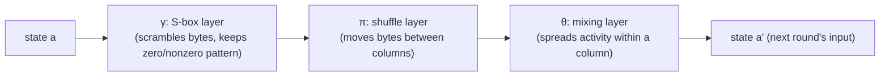
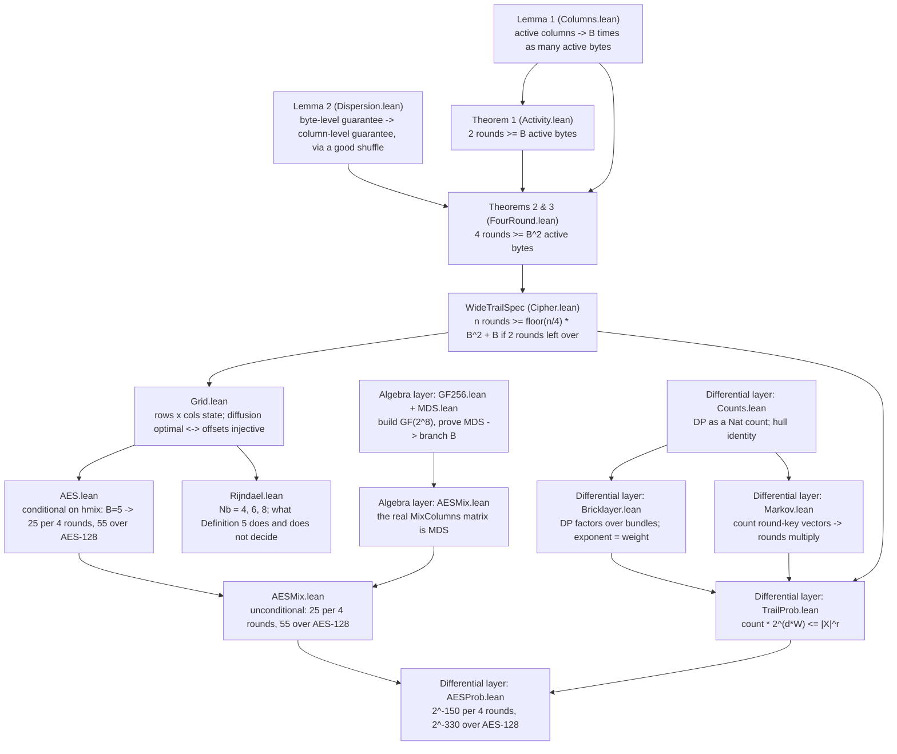

# WideTrail

*Kernel-checked wide-trail and HADES activity bounds, concrete AES algebra, and exact differential trail counts in Lean 4.*

Based on Daemen and Rijmen's [The Wide Trail Design Strategy](https://doi.org/10.1007/3-540-45325-3_20) (Cryptography and Coding 2001, LNCS 2260, pp. 222–238; see [`paper/`](paper/)).

---

## Building and checking

You need [elan](https://github.com/leanprover/elan), the Lean toolchain manager, and git.
The toolchain is pinned in [`lean-toolchain`](lean-toolchain) (Lean `v4.33.1`) and Mathlib in
[`lakefile.toml`](lakefile.toml) (`v4.33.1`); elan and Lake fetch both.

```bash
git clone https://github.com/4waan/Wide-Trail-formal-verification.git
cd Wide-Trail-formal-verification
lake exe cache get    # prebuilt Mathlib files, instead of compiling Mathlib
lake build            # the default library WideTrail
```

A successful `lake build` means every theorem in the default library has been checked by
Lean's kernel. Two further checks run in CI:

```bash
lake env lean scripts/AuditAxioms.lean   # only propext, Classical.choice, Quot.sound
python3 scripts/check_imports.py         # every module is reachable from a library root
```

The default library leaves out three check modules that evaluate whole width-16 Poseidon2
permutations in the kernel. Each needs 7 to 12 GB of memory to elaborate, so they live in a
separate library, `WideTrailHeavy`. Lake builds independent modules in parallel, so build
them one at a time:

```bash
lake build WideTrail.Poseidon2.Checks.KoalaBear   # about 12 GB
lake build WideTrail.Poseidon2.Checks.BabyBear    # about 7 GB
lake build WideTrail.Poseidon2.Checks.Plonky3     # about 7 GB
lake build WideTrailHeavy
lake env lean scripts/AuditAxiomsHeavy.lean      # the audit with these checks included
```

No module of the default library measured above about 3 GB. Lake runs one Lean process
per core, so the peak of the default build grows with the number of cores.

To cite this project, see [`CITATION.cff`](CITATION.cff).

---

## Named proof layers

The directories identify the kind of mathematics they contain: `Propagation`,
`Algebra`, `Differential`, `Hades`, and `Poseidon2`. The original numbered directories have been
renamed; import paths now use these names. Import a complete layer with
`import WideTrail.Propagation`, `import WideTrail.Algebra`,
`import WideTrail.Differential`, `import WideTrail.Hades`, or
`import WideTrail.Poseidon2`.

**Propagation layer** (`WideTrail/Propagation/`) is the abstract propagation theory: an S-box layer, a
shuffle, and a mixing layer, related only by the structural properties a wide-trail cipher
needs (support-preservation, diffusion optimality, a branch number). It's parametric, the
branch number, state size, and field are all just parameters, so it proves a bound for an
entire *family* of cipher shapes at once, AES included. Instantiated at the AES shape, it
gives `aes_four_round`/`aes128_ten_round` as an **implication**: *given* that MixColumns has
branch number `5`, four rounds force `25` active S-boxes and the ten rounds of AES-128 force
`55`. The `hmix`/`hnd` hypotheses in `Propagation/AES.lean` are exactly that "given."

The state is rectangular, `Fin rows × Fin cols`, not square, so the whole Rijndael family is
in range: `Propagation/Rijndael.lean` covers the 192- and 256-bit block sizes as well, and uses
them to test what the theory actually decides about a real design choice.

**Algebra layer** (`WideTrail/Algebra/`) discharges that hypothesis. It builds `GF(2⁸)` from scratch
(Mathlib's `GaloisField` is `noncomputable`, unusable for the enumeration this needs), proves
the general "MDS matrix ⟹ optimal branch number" theorem, vocabulary Mathlib doesn't have at
all, and instantiates both against the real `4×4` AES `MixColumns` matrix. The output is
`Algebra/AESMix.lean`'s `aes_four_round_concrete`/`aes128_ten_round_concrete`: the same two
bounds, now with *no* remaining hypothesis except the free fact that the S-box layer is a
bijective bricklayer (true for any invertible S-box, AES's included). The same layer holds
the linear algebra of the Poseidon2 layers over any field: Plonky3's `4×4` matrix, the
block-circulant external layer and its branch number, the internal layer `c (diag d + J)`,
and their transposes.

**Differential layer** (`WideTrail/Differential/`) turns the count into a probability. A differential's
probability is kept as a `Nat` numerator over a fixed denominator, never a rational, so
every statement stays exact and stays decidable on a small cipher. Three steps: a
bricklayer's differential count factors over bundles, and the number of factors that are not
free is exactly Propagation layer's `weight`; the rounds multiply; and `4 · 2⁶ = 256` turns each active
AES S-box into a factor of `2⁻⁶`. Out comes `2⁻¹⁵⁰` over four rounds and `2⁻³³⁰` over the ten
rounds of AES-128.

The multiplication step is the one that needs an assumption, and Differential layer does not assume the
product formula. It counts pairs of an input and a **round-key vector**, so independent round
keys are visible in what is being counted, and then *proves* the product. That is not a
stylistic preference: assuming the product formula at a fixed key is inconsistent for
ten-round AES, and `Differential/Checks/Toy.lean` exhibits a cipher, a trail and a key where
the key-averaged count is positive and the fixed-key count is zero. Differential layer also proves,
unconditionally, that a differential is a *sum* over trails and exhibits a two-round
differential worth twice its best trail, which is the hull effect that caveats every
wide-trail figure in the literature. `Differential/Hull.lean` then bounds the differential
itself, the whole sum, in the same independent-key model: over two bricklayer rounds with
bijective S-boxes of uniformity at most `u` and a first linear layer of branch number at
least `B`, every differential with a nonzero input difference has key-averaged
probability at most `(u / |K|)^(B - 1)` (`Scheduled.bricklayer_two_round_bound`). Only
those two rounds are charged, and the bound concerns the keys averaged over:
`Differential/Checks/Hull.lean` gives a toy cipher on which it fails with the keys fixed
to zero.

Differential layer also demotes one of Propagation layer's hypotheses to a theorem. `PreserveSupport` was a claim
about a function on differences, and a real S-box layer has no such function; what it really
guarantees is that any output difference it *can* produce has the same support as the input.
Differential layer proves that from injectivity alone, and Propagation layer's four-round theorems were generalised
to consume it, with the old function-shaped statements surviving unchanged as corollaries.

**Hades layer** (`WideTrail/Hades/`) models full and partial S-box rounds with fixed
additions and round-specific invertible linear maps. It counts active coordinates
only where an S-box is actually applied. For `r` full rounds, `m` partial rounds,
and `s` full rounds, its execution theorem gives
`(r / 2 + s / 2) * B + r % 2 + s % 2` active S-boxes from the outer blocks.
Whole-state MDS mixing supplies `B = t + 1`. The activity result applies to actual pairs of
distinct inputs. `Counting.lean` and `Probability.lean` now connect masked activity
to exact differential trail counts in the explicitly independent-key model.
`Subspace.lean` charges the middle rounds too: when no nonzero difference stays
off the S-box coordinates through `w` consecutive partial rounds with the internal
linear map, the `m` middle rounds add `m / w` active S-boxes (`outer_middle_bound`), and the
same term enters the probability bridge (`hades_probability_with_middle`). Fewer
than `width / mask size` rounds always leave a nonzero inactive difference
(`inactiveSpace_ne_bot`). The trail bounds also keep the ratio `|K| / u` per charged
S-box exact (`hades_probability_exact`, `hades_probability_with_middle_exact`).
`Dimension.lean` gives the exact dimensions of the inactive spaces: with one S-box
coordinate, once no nonzero difference stays inactive through `width` consecutive
partial rounds, each round removes exactly one dimension
(`finrank_inactiveSpace_singleton`), and for the Poseidon2 internal layer
`c (diag d + J)` that happens exactly when the diagonal entries off the S-box
coordinate are pairwise distinct (`inactiveSpace_diagPlusOnes_card_eq_bot_iff`).
`Hull.lean` bounds a key-averaged differential, not only a trail, over two full rounds
(`hades_differential_bound`).
See [the HADES mechanics](MECHANICS_HADES.md) and [the implementation plan](HADES_PLAN.md).

**Poseidon2 layer** (`WideTrail/Poseidon2/`) certifies the pinned reference BN254
width-three instance: field primality, the actual fifth-power S-box, both linear
inverses, external MDS mixing, permutation bijectivity, and at least 34 active
S-boxes per distinct input pair, 16 from the outer rounds and 18 from the partial
rounds. Its checked execution traces match the pinned upstream known-answer vector
and the vector of SP1's gnark test for the same permutation, which SP1 uses for its
outer recursion and wrap stages. It also certifies the two width-sixteen
permutations SP1 uses for its main proof system, through one generic model of the
Plonky3 code: KoalaBear (SP1 6.10.0, `x^3`, twenty partial rounds) with at least 33
active S-boxes per distinct input pair, and BabyBear (SP1 5.2.4, `x^7`, thirteen
partial rounds) with at least 32. For each instance the independent-key trail bound is
also stated as an exact ratio, which gives the exponents 989 (KoalaBear), 906 (BabyBear)
and 8554 (BN254), each the largest this arithmetic allows; a key-averaged differential
bound charges the first two full rounds. All of these concern one trail, or the
differential averaged over an additional independent uniform key per round, not the
permutation with its fixed constants. The models of both width-sixteen instances
reproduce the known-answer vectors of the upstream `p3-koala-bear` and `p3-baby-bear`
crates, with those tests' own round constants.
See [the concrete certificates and their scope](PRODUCTION_CERTIFICATE.md).

Named theorem footprints are pinned by `#print axioms`. The complete module audit
in `scripts/AuditAxiomsHeavy.lean` checks every project declaration, including names in
the root namespace (`scripts/AuditAxioms.lean` does the same for the default library). Both
allow nothing beyond
the standard `propext, Classical.choice, Quot.sound` baseline: no `sorry`, no
`native_decide`, no `bv_decide` fallback axiom, anywhere. See
[`WideTrail/Algebra/MDS_HYPOTHESIS_BUILD.md`](WideTrail/Algebra/MDS_HYPOTHESIS_BUILD.md) for the
build log of Algebra layer (what was tried, what failed, why),
[`MECHANICS_ALGEBRA.md`](MECHANICS_ALGEBRA.md) for how the algebra works,
[`MECHANICS_PROPAGATION.md`](MECHANICS_PROPAGATION.md) for the support argument, and
[`MECHANICS_DIFFERENTIAL.md`](MECHANICS_DIFFERENTIAL.md) for the same on Differential layer.

---

## What's in each file

The files import each other in this order, each one building on the last.

### [`WideTrail.lean`](WideTrail.lean)
The entry point. It just imports every file below, so the whole library is one `import WideTrail` away.

### Propagation layer: the abstract theory

#### [`WideTrail/Propagation/Activity.lean`](WideTrail/Propagation/Activity.lean)
The foundation. Defines what it means for a position in the cipher's state to be "active" (its difference is nonzero), counts how many positions are active (the *weight*), and proves the basic two-round bound: across any two rounds, the number of active positions is at least the branch number of the mixing layer.

#### [`WideTrail/Propagation/Columns.lean`](WideTrail/Propagation/Columns.lean)
Groups the state into columns, the way AES groups bytes into 4-byte columns, and proves that if the mixing layer guarantees a minimum spread within each column, that spread adds up: any set of active columns forces that many times more active bytes overall (**Lemma 1**).

#### [`WideTrail/Propagation/Dispersion.lean`](WideTrail/Propagation/Dispersion.lean)
Models the shuffle step (like ShiftRows) that scrambles which column each byte belongs to between rounds. Proves that if this shuffle is "diffusion optimal", meaning no two bytes from the same column ever end up sharing a column again, then a column-level guarantee can be upgraded into a stronger bundle-level one (**Lemma 2**).

#### [`WideTrail/Propagation/FourRound.lean`](WideTrail/Propagation/FourRound.lean)
Combines Lemma 1 and Lemma 2 into the paper's two headline theorems: any four consecutive rounds of a wide-trail cipher force at least `B²` active S-boxes, where `B` is the branch number of the mixing layer. It's proved for both of the paper's cipher shapes, to show they agree.

#### [`WideTrail/Propagation/Cipher.lean`](WideTrail/Propagation/Cipher.lean)
Packages a whole cipher design (its column layout, S-box, shuffle, mixing layer, and the proof obligations they must satisfy) into a single structure, `WideTrailSpec`. Also extends the four-round theorem to any number of rounds by chaining four-round blocks together.

#### [`WideTrail/Propagation/Grid.lean`](WideTrail/Propagation/Grid.lean)
Instantiates the abstract theory on a rectangular `rows × cols` state with ShiftRows at an arbitrary offset vector. The whole file turns on one equivalence: the paper's geometric "diffusion optimal" condition on a permutation of `rows · cols` positions is *exactly* injectivity of the offset vector. That collapses a design criterion into something the kernel can decide for any concrete candidate, count in closed form, and refute. It also proves, for every possible shuffle and not just rotations, that a state with more rows than columns admits no diffusion-optimal shuffle at all.

#### [`WideTrail/Propagation/AES.lean`](WideTrail/Propagation/AES.lean)
Plugs the real AES shape into `WideTrailSpec`: the square case of the grid, ShiftRows as the shuffle, and a MixColumns with branch number 5 (a property of AES that's taken as a hypothesis here, `hmix`/`hnd`, rather than re-derived from finite-field arithmetic; Algebra layer is what discharges it). Out comes the actual numbers: at least 25 active S-boxes over any four rounds, 55 over the ten rounds of AES-128, 75 over the twelve of AES-192, and 80 over the fourteen of AES-256.

#### [`WideTrail/Propagation/Rijndael.lean`](WideTrail/Propagation/Rijndael.lean)
Rijndael at all three block sizes, and the place where the formalization is asked to rule on a real design decision. Rijndael shifts its rows by `0,1,2,3` at 128- and 192-bit blocks but by `0,1,3,4` at 256 bits. The kernel's verdict on the natural explanation is *no*: `0,1,2,3` is diffusion-optimal on the wide state too, along with 1678 other offset vectors, so the wide-trail criterion is not what rejected it. The criterion is not vacuous either, the 256-bit offsets are illegal on the AES state, and a 4×3 state admits no diffusion-optimal shuffle whatsoever.

#### [`WideTrail/Propagation/Checks/Verification.lean`](WideTrail/Propagation/Checks/Verification.lean)
A sanity-check file, not a source of new results. It builds a toy cipher to show the theorems' assumptions can all hold at once (so nothing here is vacuously true), and builds a second toy cipher that is missing only the "diffusion optimal" shuffle property to show the bound genuinely breaks without it.

#### [`WideTrail/Propagation/Checks/Tightness.lean`](WideTrail/Propagation/Checks/Tightness.lean)
Measures how much slack is in the bounds on the one cipher small enough to search exhaustively (`toySpec`, a `2×2` state over `GF(2)`): the two-round bound turns out exactly tight, the four-round bound looser.

#### [`WideTrail/Propagation/Checks/Axioms.lean`](WideTrail/Propagation/Checks/Axioms.lean)
Audits the axiom footprint of the toy-cipher checks: confirms every finite check in the project runs through kernel `decide`, never `native_decide`, so nothing here quietly moved trust out of the kernel.

### Algebra layer: discharging MixColumns

#### [`WideTrail/Algebra/GF256.lean`](WideTrail/Algebra/GF256.lean)
`GF(2⁸)` built from scratch as `BitVec 8` under xor and shift-and-reduce multiplication, proved a genuine `Field`, commutativity and associativity by bilinear extension from a 64/512-case basis check (not brute force, which hits a kernel recursion-depth wall well before it could finish), inverses by an unrolled Fermat exponentiation.

#### [`WideTrail/Algebra/MDS.lean`](WideTrail/Algebra/MDS.lean)
The general theorem: if every square submatrix of a matrix `M` is nonsingular (the MDS property), then `{(x, Mx)}` has the optimal branch number `n+1`, vocabulary Mathlib has none of (no MDS matrices, no minimum distance, no Singleton bound anywhere in the library).

#### [`WideTrail/Algebra/AESMix.lean`](WideTrail/Algebra/AESMix.lean)
The real `4×4` AES `MixColumns` matrix over `GF256`, proved MDS (all 69 minors nonsingular), and wired through Propagation layer's `aes_four_round`/`aes128_ten_round` to produce the fully unconditional `aes_four_round_concrete`/`aes128_ten_round_concrete` (25 and 55), plus the same for AES-192 and AES-256 (75 and 80).

#### [`WideTrail/Algebra/AESSbox.lean`](WideTrail/Algebra/AESSbox.lean)
The FIPS 197 byte substitution: inversion in `GF(2⁸)` followed by the binary affine map with constant `0x63`, an executable inverse, and a proof of bijectivity.

#### [`WideTrail/Algebra/PowerSbox.lean`](WideTrail/Algebra/PowerSbox.lean)
A power map `x ↦ x^e` as an executable equivalence with inverse `x ↦ x^d`, whenever `e d = (q - 1) k + 1` and every nonzero `x` satisfies `x^(q - 1) = 1` (`Sbox.powerEquivOfFermat`). No enumeration of the field is needed.

#### [`WideTrail/Algebra/MDS4.lean`](WideTrail/Algebra/MDS4.lean)
Plonky3's `4×4` matrix `circ(2, 3, 1, 1)` over any field. It is MDS exactly when `2, 3, 5, 7, 11` and `17` are nonzero (`m4_isMDS_iff`), so its branch number is then `5`. Its determinant is `-35`, which gives an explicit inverse.

#### [`WideTrail/Algebra/BlockCirculant.lean`](WideTrail/Algebra/BlockCirculant.lean)
The Poseidon2 external layer as a block circulant `circ(2N, N, …, N)`: block `i` of the output is `N (xᵢ + ∑ⱼ xⱼ)`. If `N` has branch number `p + 1` on blocks of size `p`, and `1, …, b + 1` are nonzero for `b` blocks, the whole layer has branch number at least `min(b + p, 2(p + 1))`. At width sixteen that is `8`. The checks show the characteristic hypothesis cannot be dropped, and that the bound is attained in a small case over `ZMod 7`. On states whose blocks sum to zero the layer applies `N` to each block with no mixing between blocks (`blockMix_of_blockSum_eq_zero`); these states form a subspace of dimension `(b - 1) p` (`finrank_blockSumZero`), and when `N` is injective and `b + 1 ≠ 0` a state lies in it exactly when its image does (`blockMix_mem_blockSumZero_iff`). These are facts about the linear map alone, not about any attack.

#### [`WideTrail/Algebra/DiagPlusOnes.lean`](WideTrail/Algebra/DiagPlusOnes.lean)
The Poseidon2 internal layer `c (diag d + J)` as a linear equivalence, with the Sherman–Morrison inverse. It needs `c ≠ 0`, every `dᵢ ≠ 0` and `1 + ∑ 1/dᵢ ≠ 0`. The map is self-adjoint for the dot product, which `Hades/Krylov.lean` uses.

#### [`WideTrail/Algebra/Transpose.lean`](WideTrail/Algebra/Transpose.lean)
Transposes of the Poseidon2 linear layers. A square matrix is MDS exactly when its transpose is; the transpose of `circ(2, 3, 1, 1)` is `circ(2, 1, 1, 3)`, MDS under the same hypothesis; the transpose of `circ(2A, A, …, A)` is `circ(2Aᵀ, Aᵀ, …, Aᵀ)`, and at width sixteen it has branch number at least `8`; `c (diag d + J)` is symmetric. Taking the linear branch number of a map to be the differential branch number of its transpose, a definition here and not a proved statement about correlations, the differential branch-number bounds carry over. No correlation, linear trail or linear-attack bound is proved.

#### [`WideTrail/Algebra/Checks/`](WideTrail/Algebra/Checks/)
`MDS4.lean` shows over `ZMod 11` and `ZMod 7` that `circ(2, 3, 1, 1)` fails to be MDS when `11` or `7` vanishes, and that branch number `5` is attained over `ZMod 13`. `BlockCirculant.lean` shows that the characteristic hypothesis of the block-circulant bound cannot be dropped and that the bound is attained. `Axioms.lean` pins the axiom footprints of the layer's results.

### Differential layer: from active S-boxes to a probability

#### [`WideTrail/Differential/Counts.lean`](WideTrail/Differential/Counts.lean)
What a differential probability is, without measure theory: `diffCount F a b` counts the inputs realising the differential, and `DP ≤ 2⁻ᵈ` is written `diffCount * 2 ^ d ≤ |X|`, exact in `ℕ` and decidable. Proves that a row of the difference distribution table sums to `|X|`, that round keys and invertible linear layers change no count, and the hull identity: the differential of a composition is a *sum* over intermediate differences, unconditionally.

#### [`WideTrail/Differential/Bricklayer.lean`](WideTrail/Differential/Bricklayer.lean)
The join between the two halves of the project. A bricklayer's differential count factors over bundles, and splitting that product over the support gives `u ^ weight a * |K| ^ (|Idx| - weight a)`: Propagation layer's `weight` appears as an exponent with no translation step. Also proves the support-preservation that Propagation layer had to assume, from injectivity of the S-boxes alone.

#### [`WideTrail/Differential/Markov.lean`](WideTrail/Differential/Markov.lean)
The Markov cipher model, with the assumption in the shape of what is counted rather than in a hypothesis: the count ranges over round-key vectors, so independent round keys are explicit, and the product formula is then a theorem. Proved by peeling one round at a time, which is the change of variables `yₙ = xₙ + kₙ` in disguise.

#### [`WideTrail/Differential/TrailProb.lean`](WideTrail/Differential/TrailProb.lean)
The arithmetic, once: `trailKeyCount · 2 ^ (d·W) ≤ |X| ^ r`. Plus the bridge that lets Propagation layer count a real differential trail, since a trail with a nonzero count satisfies `WideTrailSpec.IsTrail`.

#### [`WideTrail/Differential/AESProb.lean`](WideTrail/Differential/AESProb.lean)
The numbers. `|K| = 256`, `|Idx| = 16`, S-box uniformity `4`, and `4 · 2⁶ = 256`, so each active S-box costs `2⁻⁶`: `2⁻¹⁵⁰` over four rounds, `2⁻³³⁰` over ten, `2⁻⁴⁵⁰` over twelve, `2⁻⁴⁸⁰` over fourteen. The generic theorem retains explicit S-box hypotheses. `AESConcrete.lean` now discharges them for the actual AES S-box, using its proved inverse and a structural differential-uniformity proof.

#### [`WideTrail/Differential/Polynomial.lean`](WideTrail/Differential/Polynomial.lean), [`WideTrail/Differential/AESConcrete.lean`](WideTrail/Differential/AESConcrete.lean)
Differential bounds from polynomial root counts, with no enumeration of the field: apart from two exceptional inputs, a differential solution of inversion is a root of a nonzero quadratic. `AESConcrete.lean` carries this through the AES affine map, proves that the count `4` is attained, and discharges the S-box hypotheses of the AES trail bounds.

#### [`WideTrail/Differential/Scheduled.lean`](WideTrail/Differential/Scheduled.lean)
The Markov product formula for round-specific nonlinear and linear maps, counted over independent round-key vectors, which the Hades layer uses.

#### [`WideTrail/Differential/Hull.lean`](WideTrail/Differential/Hull.lean)
Differentials, not trails, in the additional-independent-key model. `diffKeyCount` counts the key vectors under which an input pair reaches a given output difference; it does not depend on the input (`diffKeyCount_const`), composes as a sum over intermediate differences (`diffKeyCount_add`), and over `r + 1` rounds is the sum of the trail counts of all trails from `a` to `b` (`diffKeyCount_succ_eq_sum_trailKeyCount`). The two-round bound: for bricklayer rounds with bijective S-boxes of uniformity at most `u` and a first linear layer of branch number at least `B`, `diffKeyCount * |K|^(B - 1) ≤ u^(B - 1) * |Idx → K|^2` for every nonzero input difference (`diffKeyCount_two_round_bound`, `bricklayer_two_round_bound`), and the same ratio over any number of bijective rounds containing two such rounds (`diffKeyCount_bound_of_two_rounds`). Only two rounds are charged, and nothing is said about a fixed key or fixed round constants.

#### [`WideTrail/Differential/PowerMap.lean`](WideTrail/Differential/PowerMap.lean)
The power map `x ↦ x^d` over any field has differential uniformity at most `d - 1` when `d` is nonzero in the field: for a nonzero input difference, the equation is a polynomial of degree `d - 1`. The checks show the bound is attained for `x^3` over `ZMod 7` and `x^7` over `ZMod 29`, and fails over `ZMod 3`, where `3 = 0`.

#### [`WideTrail/Differential/Checks/Toy.lean`](WideTrail/Differential/Checks/Toy.lean)
A sixteen-state cipher the kernel enumerates in full. Recomputes the bundle product and the Markov product by brute force, shows the S-box uniformity constant is exactly attained, exhibits a fixed key under which the product formula is false, and exhibits a two-round differential worth twice its best trail.

#### [`WideTrail/Differential/Checks/PowerMap.lean`](WideTrail/Differential/Checks/PowerMap.lean)
The power-map bound is attained for `x^3` over `ZMod 7` and for `x^7` over `ZMod 29`, and its conclusion fails without its hypotheses: over `ZMod 3`, where `3 = 0`, and for `d = 1`.

#### [`WideTrail/Differential/Checks/Hull.lean`](WideTrail/Differential/Checks/Hull.lean)
The two-round bound on a twenty-five-state cipher over `ZMod 5`: it allows `100` of the `625` key pairs, and the kernel finds a maximum of `85` over all differentials with a nonzero input difference (`toy_count_le`, `toy_count_max`). With both keys fixed to zero, one differential is realised by `5` of the `25` inputs, above the bound (`toy_fixed_exceeds`): the bound is a statement about the key-averaged model only.

#### [`WideTrail/Differential/Checks/Axioms.lean`](WideTrail/Differential/Checks/Axioms.lean)
The same axiom audit as Propagation layer, applied to the probability layer: twenty-six results, all on the standard baseline, none through `native_decide`.

---

### Hades layer: scheduled full and partial rounds

#### [`Masked.lean`](WideTrail/Hades/Masked.lean)
Defines masked coordinate S-boxes and `sboxWeight`, the charged activity. Proves
bijectivity, support preservation for actual input pairs, and exact propagation
through identity coordinates.

#### [`Schedule.lean`](WideTrail/Hades/Schedule.lean)
Defines executable pre-addition rounds, their inverses, finite executions, and
actual difference traces. A full/partial/full schedule has explicit lengths and
proved boundaries. Round additions remain deterministic parameters.

#### [`Bounds.lean`](WideTrail/Hades/Bounds.lean)
Proves shifted full-window bounds and `outerRound_bound`. Pairs of full rounds
cost a branch bound; an odd remaining full round costs one. The two outer blocks
are counted separately. `hades_mds_bound` supplies the whole-state MDS corollary.

#### [`Counting.lean`](WideTrail/Hades/Counting.lean), [`Probability.lean`](WideTrail/Hades/Probability.lean)
`Counting.lean` factors the exact differential count of a masked S-box layer; identity
coordinates are never charged. `Probability.lean` connects charged activity to trail
counts in the model with an additional independent uniform key per round: a trail with a
nonzero count is a support-correct trail, and `hades_probability` charges `d` bits per
charged S-box when `u * 2^d ≤ |K|`. `hades_probability_exact` keeps the ratio `|K| / u`
exact instead, and `mul_le_of_ratio` turns such a ratio into a power of two. These bound
one trail, not the permutation with its fixed constants.

#### [`Subspace.lean`](WideTrail/Hades/Subspace.lean)
Shows that an inactive round acts on the difference by its linear map alone, so the
differences that stay inactive through `r` consecutive partial rounds form a subspace.
If that subspace is trivial, every window of `r` middle rounds activates an S-box;
differences inside it cross the window for free. Combines the outer and middle counts,
carries them into the independent-key trail bound, and proves by rank-nullity that too
short a window always leaves a nonzero inactive difference.

#### [`Krylov.lean`](WideTrail/Hades/Krylov.lean)
Turns "no nonzero difference stays off the S-box coordinate through `r` consecutive
partial rounds" into finite checks. For a self-adjoint internal map, the conditions are
dot products with the vectors `Lʲ e₀`. A table of those vectors and a left inverse, both
checked by `decide`, prove the inactive space trivial. A nonzero scalar in front of the
map does not matter.

#### [`Dimension.lean`](WideTrail/Hades/Dimension.lean)
How the inactive space shrinks as the window grows, for any linear map and mask. The
chain of spaces is constant from `width` rounds on (`inactiveSpace_eq_card`), and the
space for `width` rounds is the largest `L`-invariant subspace of differences inactive in
one round; it is trivial exactly when no nonzero difference stays inactive forever
(`no_infinite_inactive_trail`). With one S-box coordinate, if that space is trivial the
differences that stay inactive through `r` consecutive partial rounds have dimension
exactly `width - r` (`finrank_inactiveSpace_singleton`). For the Poseidon2 internal layer
`c (diag d + J)`, the space for `width` rounds is trivial exactly when the diagonal entries
off the S-box coordinate are pairwise distinct
(`inactiveSpace_diagPlusOnes_card_eq_bot_iff`), which needs no table, and the dimensions
are then exactly `width - r` (`finrank_inactiveSpace_diagPlusOnes`). These concern
differences that avoid the partial-round S-boxes only, not subspace trails in general.

#### [`Hull.lean`](WideTrail/Hades/Hull.lean)
Bounds a differential, the sum over all trails from `a` to `b`, through the scheduled
rounds in the additional-independent-key model. If two adjacent rounds are full, their
S-boxes have uniformity at most `u`, and the first has a linear layer of branch number at
least `B`, then every differential with a nonzero input difference has key-averaged
probability at most `(u / |K|)^(B - 1)` (`diffKeyCount_bound_of_two_full_rounds`,
`hades_differential_bound`). Only those two rounds are charged; nothing is said about the
fixed round constants alone.

#### [`Checks`](WideTrail/Hades/Checks/)
`Toy.lean`: a 25-state cipher over `ZMod 5` checks the count, exhibits a tight witness,
and shows why identity coordinates must be excluded. Weak mixing and a collapsing middle
map refute bounds stated without their required assumptions. `Counting.lean` checks the
masked and scheduled counts by enumeration. `Krylov.lean` checks the certificate route on a
four-coordinate internal matrix over `ZMod 13` and shows that self-adjointness cannot be
dropped. `Dimension.lean` shows over `ZMod 5` that a repeated diagonal entry leaves a
nonzero difference inactive forever, and that with a mask of two coordinates one round can
remove two dimensions. `Axioms.lean` pins the axiom footprints.

---

### Poseidon2 layer: concrete permutations

#### [`BN254Parameters.lean`](WideTrail/Poseidon2/BN254Parameters.lean), [`BN254Primality.lean`](WideTrail/Poseidon2/BN254Primality.lean), [`BN254.lean`](WideTrail/Poseidon2/BN254.lean)
The reference BN254 width-three permutation: its 192 constants, primality by Lucas
certificates, the fifth-power S-box, both linear layers with inverses, bijectivity,
and 16 active S-boxes in the outer rounds.

#### [`BN254Middle.lean`](WideTrail/Poseidon2/BN254Middle.lean)
Charges the 56 internal rounds: no nonzero difference stays inactive through three
consecutive partial rounds, and some does through two, so every distinct input pair
incurs at least 34 active S-boxes. The internal matrix is `diag (1, 1, 2) + J`, so the
diagonal criterion proves the three-round statement again and gives exactly `3 - r`
inactive dimensions. The trail bound keeps the ratio `p / 4` exact, which gives the
exponent 8554, and a key-averaged differential bound charges the first two external
rounds (exponent 754).

#### [`BN254Execution.lean`](WideTrail/Poseidon2/BN254Execution.lean), [`BN254Checks.lean`](WideTrail/Poseidon2/BN254Checks.lean)
A materialised runner proved equal to the specification, a checked 64-round
trace, and the upstream `[0, 1, 2]` known-answer vector.

#### [`Checks/BN254SP1.lean`](WideTrail/Poseidon2/Checks/BN254SP1.lean)
SP1's gnark test vector for its BN254 outer permutation, input `(0, 0, 0)`, proved
for the same Lean permutation.

#### [`Plonky3.lean`](WideTrail/Poseidon2/Plonky3.lean)
The width-sixteen Plonky3 permutation over any field, as SP1 configures it. The
external layer is proved equal to a transcription of the code's
`mds_light_permutation`; the internal layer is `R⁻¹ (diag d + J)` with SP1's diagonal.
Bijectivity, at least 32 active S-boxes from the full rounds, the partial-round
term, and the independent-key trail bound hold for every round-constant table, the
trail bound also as an exact ratio. Also: the diagonal criterion and exact inactive
dimensions for the internal layer, a key-averaged differential bound over the first two
full rounds, the states with zero block sum on which the external layer acts block by
block, and the transposes of both layers.

#### [`Plonky3Execution.lean`](WideTrail/Poseidon2/Plonky3Execution.lean)
A materialised runner for the width-sixteen permutation, with every coordinate a named
field and every layer written out coordinate by coordinate. It is proved equal to the
specification for every scale, S-box, constant table, number of partial rounds, input and
round count, so `decide` on the runner proves statements about the model.

#### [`KoalaBear.lean`](WideTrail/Poseidon2/KoalaBear.lean), [`BabyBear.lean`](WideTrail/Poseidon2/BabyBear.lean)
The SP1 instances, with primality, the S-box, the Montgomery factor and the
pinned constants. KoalaBear: no nonzero difference stays inactive through sixteen
consecutive partial rounds, so at least 33 active S-boxes; trail exponent 957, or 989
with the exact ratio. BabyBear: at least 32, trail exponent 896, or 906 with the exact
ratio; its thirteen partial rounds add nothing, exactly 3 dimensions of differences stay
inactive through them, and some input pairs cross them without activating an S-box.
Both: the diagonal criterion, exactly `16 - r` inactive dimensions, and key-averaged
differential exponents 209 (KoalaBear) and 198 (BabyBear).

#### [`Checks`](WideTrail/Poseidon2/Checks/)
Why each exponent and margin is what it is, which hypotheses cannot be dropped, and
end-to-end runs. The uniformity (2 and 6), the external branch number (8) and the window
(16) are each shown to be exact, and each sharp exponent fails when increased by one
(for BN254 in `BN254Checks.lean`). `Plonky3KAT.lean` shows that the models of both
instances reproduce the known-answer vectors of the upstream `p3-koala-bear` and
`p3-baby-bear` crates, with those tests' own constants, and that each vector fails
without the Montgomery factor, without the initial external layer, or with the raw
samples read as canonical values. The pinned-constant outputs are regression values from
an outside model, since no published vector exists for either SP1 instance.
`Axioms.lean` pins the axiom footprints of the certificates.

---

## How this works as a program, and why it's useful

At its core, this project turns a cipher's design into a small set of numbers, and a machine-checked proof that those numbers can't be beaten.

### The shape of a round

Every round of a wide-trail cipher is the same three steps, one after another:



Only the mixing layer `θ` can actually reduce how "spread out" a difference is; the S-box layer never merges positions together, and the shuffle only relocates them. That's the entire reason the argument works: count what `θ` guarantees, and you've counted what the whole round guarantees.

### From one round to a certified bound

The files build the proof up in layers, each one feeding the next:



[`WideTrail/Propagation/Checks/`](WideTrail/Propagation/Checks/) and
[`WideTrail/Differential/Checks/`](WideTrail/Differential/Checks/) sit off to the side of this chain: it doesn't add a new theorem, it stress-tests the ones above by trying to break them with small hand-built examples, measures how tight the bounds are, and audits that everything really is kernel-checked.

### Why this is useful

Normally, bounding what differential cryptanalysis can do against a cipher means hand-checking (or exhaustively searching) huge numbers of specific trails, one cipher at a time. This project instead proves an activity bound that holds for an entire *family* of cipher designs at once, AES included, as long as the design follows the wide-trail shape: an S-box layer, a well-mixing layer, and a shuffle that spreads columns well. The differential layer turns such counts into trail bounds, and bounds two-round differentials from the branch number directly, in a model with independent round keys. Linear cryptanalysis is not covered: no correlation, linear trail or linear hull is formalised. The only related results are the transpose facts of `Algebra/Transpose.lean`, which carry the differential branch-number bounds of the Poseidon2 linear layers over to linear branch numbers, under a definition of the linear branch number that is taken, not proved.

Two things make that bound trustworthy:

- **It's kernel-checked.** Lean's kernel is a small, independently trusted piece of software. If the project compiles, every theorem in it is guaranteed correct by that kernel, not by a human re-reading the proof or a test suite that might miss a case.
- **It's parametric.** The branch number, the state size, and the mixing layer are all just parameters. Swap in a different design with the same shape, and the same machinery hands you a new certified bound for free, instead of redoing the argument by hand.

The activity bounds supply exponents for individual trail bounds when the required
S-box uniformity and probability model are available. The differential layer proves
this bridge for independent round keys. A differential sums multiple trails, and
fixed public constants do not provide independent keys. HADES now has both the
activity theorem and its separate independent-key counting connection.
`Differential/Hull.lean` and `Hades/Hull.lean` bound a differential, the sum over all
trails, but only over two full rounds and only averaged over independent keys; nothing
here bounds a differential of a permutation with fixed constants or under one fixed key.

---

## Appendix: the basic idea, informally

*These notes are an informal introduction to differential cryptanalysis. They are not part
of the documentation above, and nothing in them is checked by Lean.*

Take two plaintexts P and P′ that differ in a chosen way, and a cipher E_k.
Let `a' = P ⊕ P'` and `b' = E(P) ⊕ E(P')`.
When E behaves like a random permutation on 128-bit blocks, then for a fixed a′ the output
difference b′ is spread roughly uniformly over 2^128 possibilities, so any particular b′ shows
up with probability about 2^-128.
The difference propagation probability of a map h (for n-bit vectors a and a′) is

`P_h(a', b') = (2^-n)∑∆(b' + h(a + a') + h(a))`

where ∆(x) = 0 for every x except ∆(0) = 1. So the formula shows directly how the
probability is spread over the output differences.

Since this is the informal version, here is one more thing to explain.

### Why differences?

The round key enters by XOR: a and a* (where a* = a ⊕ a′) both get the key k XORed into them:
`(a ⊕ k) ⊕ (a* ⊕ k) = a ⊕ a*`, so the key cancels.
The difference passes through key addition unchanged, for every key.
The same happens at any linear layer λ, because linear means `λ(a) ⊕ λ(a*) = λ(a ⊕ a*)`: the
difference passes through and the key never enters.
So in a key-alternating cipher with three components per round, two of them handle
differences exactly and independently of the key.

**The only place where a difference behaves probabilistically at all is the S-box layer.**

### The attack and the design

The attack, in its simplest form. Suppose you find a pair (a′, b′) with probability 2^-30,
which is 2^98 times more likely than it should be. Then:

1. Collect about 2^30 plaintext pairs with difference `a'`.
2. Guess the final round key `k_r`.
3. Decrypt the last round of both ciphertexts under that guess.
4. Check whether the difference after round r − 1 matches the high-probability pattern.

Wrong guesses scramble the values and match only at random, while the right guess makes
the prediction come true about once every 2^30 pairs. The correct k_r stands out in a
counter array; then that round key is peeled off and the process repeats inwards.

The same idea once more, step by step, since neither a beginner nor ChatGPT gets the
fundamentals right away.

Two inputs:

```
P  = 01010101...
P* = 01011101...
```

They are almost the same; call the difference `a' = 00001000...`.
Encrypt both, E(P) and E(P*), and take the difference of the outputs.
Now think of a perfectly random cipher: knowing that the inputs differ by a′ tells you
nothing about how the outputs differ. The output difference could be any of the 2^128
possible 128-bit patterns, `Pr[a' -> b'] ≈ 2^-128`.

Now the weakness. Suppose you discover that when you give the cipher two inputs with
difference `a'`, the output difference is `b'` quite often, say `Pr[a' -> b'] ≈ 2^-30`.
That gives a statistical handle on the cipher's internal structure.

*How does this help find the key?*

In an AES-like cipher, P goes through, say, r rounds:

```
P -> round 1 -> ... -> round r -> ciphertext
```

The key of round r is the one we are trying to find, but you cannot see the difference
before the final round. So:

1. Decrypt the final round of the ciphertext pair with the guessed key.
2. XOR the two guessed round r − 1 values together.

Does the difference look as predicted? If the key guess is wrong, the internal values are
random garbage:

```
Key guess          Number of matches

Guess A                  0
Guess B                  1
Guess C                  0
Guess D                  2
Guess E                  947  <- whoa
Guess F                  1
Guess G                  0
```

*Differential cryptanalysis is basically finding a weird cause-and-effect relation in how
differences propagate through a cipher.* The key detector is nothing but a statistical
bias.

### Inside an S-box

Think of a small lookup table like `S : {0, 1}^8 -> {0, 1}^8`. It is invertible and
nonlinear, meaning it does not commute with XOR.

Take two inputs, x and x ⊕ a′, and pass both through the S-box:

```
x        ──> S(x)
x ⊕ a'   ──> S(x ⊕ a')
```

and look at the difference `S(x) ⊕ S(x ⊕ a')`. Suppose

```
a' = 00000001
x  = 00000000

S(x)      = something
S(x ⊕ a') = something else

output difference = S(x) ⊕ S(x ⊕ a')
```

Doing this for every x, for the input difference a′, gives a row of a DDT (difference
distribution table), something like:

```
Output difference       Number of times

00000000                     0
00110110                     2
10011001                     4  <- happens 4 times
01010111                     2
...
```
