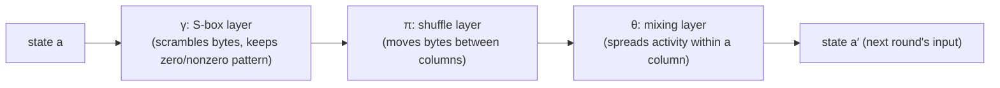
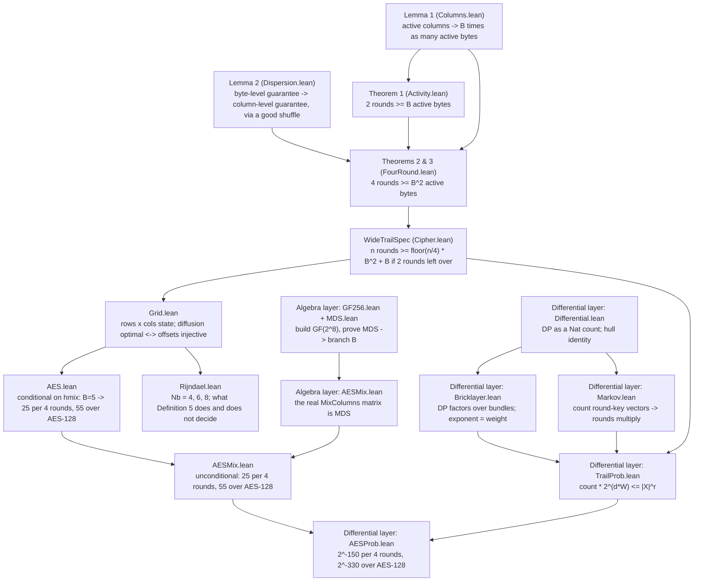

# WideTrail

*Kernel-checked wide-trail and HADES activity bounds, concrete AES algebra, and exact differential trail counts in Lean 4.*

Based on Daemen and Rijmen's [The Wide Trail Design Strategy](https://www.researchgate.net/publication/225704500_The_Wide_Trail_Design_Strategy).

---

## Named proof layers

The directories identify the kind of mathematics they contain: `Propagation`,
`Algebra`, `Differential`, `Hades`, and `Poseidon2`. The original numbered directories have been
renamed; import paths now use these names. Import a complete layer with
`import WideTrail.Propagation`, `import WideTrail.Algebra`,
`import WideTrail.Differential`, `import WideTrail.Hades`, or
`import WideTrail.Poseidon2`.

**Propagation layer** (`WideTrail/Propagation/`) is the abstract propagation theory: an S-box layer, a
shuffle, and a mixing layer, related only by the structural properties a wide-trail cipher
needs (support-preservation, diffusion optimality, a branch number). It's parametric, the
branch number, state size, and field are all just parameters, so it proves a bound for an
entire *family* of cipher shapes at once, AES included. Instantiated at the AES shape, it
gives `aes_four_round`/`aes128_ten_round` as an **implication**: *given* that MixColumns has
branch number `5`, four rounds force `25` active S-boxes and the ten rounds of AES-128 force
`55`. The `hmix`/`hnd` hypotheses in `Propagation/AES.lean` are exactly that "given."

The state is rectangular, `Fin rows × Fin cols`, not square, so the whole Rijndael family is
in range: `Propagation/Rijndael.lean` covers the 192- and 256-bit block sizes as well, and uses
them to test what the theory actually decides about a real design choice.

**Algebra layer** (`WideTrail/Algebra/`) discharges that hypothesis. It builds `GF(2⁸)` from scratch
(Mathlib's `GaloisField` is `noncomputable`, unusable for the enumeration this needs), proves
the general "MDS matrix ⟹ optimal branch number" theorem, vocabulary Mathlib doesn't have at
all, and instantiates both against the real `4×4` AES `MixColumns` matrix. The output is
`Algebra/AESMix.lean`'s `aes_four_round_concrete`/`aes128_ten_round_concrete`: the same two
bounds, now with *no* remaining hypothesis except the free fact that the S-box layer is a
bijective bricklayer (true for any invertible S-box, AES's included).

**Differential layer** (`WideTrail/Differential/`) turns the count into a probability. A differential's
probability is kept as a `Nat` numerator over a fixed denominator, never a rational, so
every statement stays exact and stays decidable on a small cipher. Three steps: a
bricklayer's differential count factors over bundles, and the number of factors that are not
free is exactly Propagation layer's `weight`; the rounds multiply; and `4 · 2⁶ = 256` turns each active
AES S-box into a factor of `2⁻⁶`. Out comes `2⁻¹⁵⁰` over four rounds and `2⁻³³⁰` over the ten
rounds of AES-128.

The multiplication step is the one that needs an assumption, and Differential layer does not assume the
product formula. It counts pairs of an input and a **round-key vector**, so independent round
keys are visible in what is being counted, and then *proves* the product. That is not a
stylistic preference: assuming the product formula at a fixed key is inconsistent for
ten-round AES, and `Differential/Checks/Toy.lean` exhibits a cipher, a trail and a key where
the key-averaged count is positive and the fixed-key count is zero. Differential layer also proves,
unconditionally, that a differential is a *sum* over trails and exhibits a two-round
differential worth twice its best trail, which is the hull effect that caveats every
wide-trail figure in the literature.

Differential layer also demotes one of Propagation layer's hypotheses to a theorem. `PreserveSupport` was a claim
about a function on differences, and a real S-box layer has no such function; what it really
guarantees is that any output difference it *can* produce has the same support as the input.
Differential layer proves that from injectivity alone, and Propagation layer's four-round theorems were generalised
to consume it, with the old function-shaped statements surviving unchanged as corollaries.

**Hades layer** (`WideTrail/Hades/`) models full and partial S-box rounds with fixed
additions and round-specific invertible linear maps. It counts active coordinates
only where an S-box is actually applied. For `r` full rounds, `m` partial rounds,
and `s` full rounds, its execution theorem gives
`(r / 2 + s / 2) * B + r % 2 + s % 2` active S-boxes from the outer blocks.
Whole-state MDS mixing supplies `B = t + 1`. The activity result applies to actual pairs of
distinct inputs. `Counting.lean` and `Probability.lean` now connect masked activity
to exact differential trail counts in the explicitly independent-key model.
See [the HADES mechanics](MECHANICS_HADES.md) and [the implementation plan](HADES_PLAN.md).

**Poseidon2 layer** (`WideTrail/Poseidon2/`) certifies the pinned reference BN254
width-three instance: field primality, the actual fifth-power S-box, both linear
inverses, external MDS mixing, permutation bijectivity, and outer-round activity.
Its checked execution trace matches the pinned upstream known-answer vector.
See [the concrete certificate and its scope](PRODUCTION_CERTIFICATE.md).

Named theorem footprints are pinned by `#print axioms`. The complete module audit
in `scripts/AuditAxioms.lean` checks every project declaration, including names in
the root namespace. Both allow nothing beyond
the standard `propext, Classical.choice, Quot.sound` baseline: no `sorry`, no
`native_decide`, no `bv_decide` fallback axiom, anywhere. See
[`WideTrail/Algebra/MDS_HYPOTHESIS_BUILD.md`](WideTrail/Algebra/MDS_HYPOTHESIS_BUILD.md) for the
build log of Algebra layer (what was tried, what failed, why),
[`MECHANICS_ALGEBRA.md`](MECHANICS_ALGEBRA.md) for how the algebra works,
[`MECHANICS_PROPAGATION.md`](MECHANICS_PROPAGATION.md) for the support argument, and
[`MECHANICS_DIFFERENTIAL.md`](MECHANICS_DIFFERENTIAL.md) for the same on Differential layer.

---

## What's in each file

The files import each other in this order, each one building on the last.

### [`WideTrail.lean`](WideTrail.lean)
The entry point. It just imports every file below, so the whole library is one `import WideTrail` away.

### Propagation layer: the abstract theory

#### [`WideTrail/Propagation/Activity.lean`](WideTrail/Propagation/Activity.lean)
The foundation. Defines what it means for a position in the cipher's state to be "active" (its difference is nonzero), counts how many positions are active (the *weight*), and proves the basic two-round bound: across any two rounds, the number of active positions is at least the branch number of the mixing layer.

#### [`WideTrail/Propagation/Columns.lean`](WideTrail/Propagation/Columns.lean)
Groups the state into columns, the way AES groups bytes into 4-byte columns, and proves that if the mixing layer guarantees a minimum spread within each column, that spread adds up: any set of active columns forces that many times more active bytes overall (**Lemma 1**).

#### [`WideTrail/Propagation/Dispersion.lean`](WideTrail/Propagation/Dispersion.lean)
Models the shuffle step (like ShiftRows) that scrambles which column each byte belongs to between rounds. Proves that if this shuffle is "diffusion optimal", meaning no two bytes from the same column ever end up sharing a column again, then a column-level guarantee can be upgraded into a stronger bundle-level one (**Lemma 2**).

#### [`WideTrail/Propagation/FourRound.lean`](WideTrail/Propagation/FourRound.lean)
Combines Lemma 1 and Lemma 2 into the paper's two headline theorems: any four consecutive rounds of a wide-trail cipher force at least `B²` active S-boxes, where `B` is the branch number of the mixing layer. It's proved for both of the paper's cipher shapes, to show they agree.

#### [`WideTrail/Propagation/Cipher.lean`](WideTrail/Propagation/Cipher.lean)
Packages a whole cipher design (its column layout, S-box, shuffle, mixing layer, and the proof obligations they must satisfy) into a single structure, `WideTrailSpec`. Also extends the four-round theorem to any number of rounds by chaining four-round blocks together.

#### [`WideTrail/Propagation/Grid.lean`](WideTrail/Propagation/Grid.lean)
Instantiates the abstract theory on a rectangular `rows × cols` state with ShiftRows at an arbitrary offset vector. The whole file turns on one equivalence: the paper's geometric "diffusion optimal" condition on a permutation of `rows · cols` positions is *exactly* injectivity of the offset vector. That collapses a design criterion into something the kernel can decide for any concrete candidate, count in closed form, and refute. It also proves, for every possible shuffle and not just rotations, that a state with more rows than columns admits no diffusion-optimal shuffle at all.

#### [`WideTrail/Propagation/AES.lean`](WideTrail/Propagation/AES.lean)
Plugs the real AES shape into `WideTrailSpec`: the square case of the grid, ShiftRows as the shuffle, and a MixColumns with branch number 5 (a property of AES that's taken as a hypothesis here, `hmix`/`hnd`, rather than re-derived from finite-field arithmetic; Algebra layer is what discharges it). Out comes the actual numbers: at least 25 active S-boxes over any four rounds, 55 over the ten rounds of AES-128, 75 over the twelve of AES-192, and 80 over the fourteen of AES-256.

#### [`WideTrail/Propagation/Rijndael.lean`](WideTrail/Propagation/Rijndael.lean)
Rijndael at all three block sizes, and the place where the formalization is asked to rule on a real design decision. Rijndael shifts its rows by `0,1,2,3` at 128- and 192-bit blocks but by `0,1,3,4` at 256 bits. The kernel's verdict on the natural explanation is *no*: `0,1,2,3` is diffusion-optimal on the wide state too, along with 1678 other offset vectors, so the wide-trail criterion is not what rejected it. The criterion is not vacuous either, the 256-bit offsets are illegal on the AES state, and a 4×3 state admits no diffusion-optimal shuffle whatsoever.

#### [`WideTrail/Propagation/Checks/Verification.lean`](WideTrail/Propagation/Checks/Verification.lean)
A sanity-check file, not a source of new results. It builds a toy cipher to show the theorems' assumptions can all hold at once (so nothing here is vacuously true), and builds a second toy cipher that is missing only the "diffusion optimal" shuffle property to show the bound genuinely breaks without it.

#### [`WideTrail/Propagation/Checks/Tightness.lean`](WideTrail/Propagation/Checks/Tightness.lean)
Measures how much slack is in the bounds on the one cipher small enough to search exhaustively (`toySpec`, a `2×2` state over `GF(2)`): the two-round bound turns out exactly tight, the four-round bound looser.

#### [`WideTrail/Propagation/Checks/Axioms.lean`](WideTrail/Propagation/Checks/Axioms.lean)
Audits the axiom footprint of the toy-cipher checks: confirms every finite check in the project runs through kernel `decide`, never `native_decide`, so nothing here quietly moved trust out of the kernel.

### Algebra layer: discharging MixColumns

#### [`WideTrail/Algebra/GF256.lean`](WideTrail/Algebra/GF256.lean)
`GF(2⁸)` built from scratch as `BitVec 8` under xor and shift-and-reduce multiplication, proved a genuine `Field`, commutativity and associativity by bilinear extension from a 64/512-case basis check (not brute force, which hits a kernel recursion-depth wall well before it could finish), inverses by an unrolled Fermat exponentiation.

#### [`WideTrail/Algebra/MDS.lean`](WideTrail/Algebra/MDS.lean)
The general theorem: if every square submatrix of a matrix `M` is nonsingular (the MDS property), then `{(x, Mx)}` has the optimal branch number `n+1`, vocabulary Mathlib has none of (no MDS matrices, no minimum distance, no Singleton bound anywhere in the library).

#### [`WideTrail/Algebra/AESMix.lean`](WideTrail/Algebra/AESMix.lean)
The real `4×4` AES `MixColumns` matrix over `GF256`, proved MDS (all 69 minors nonsingular), and wired through Propagation layer's `aes_four_round`/`aes128_ten_round` to produce the fully unconditional `aes_four_round_concrete`/`aes128_ten_round_concrete` (25 and 55), plus the same for AES-192 and AES-256 (75 and 80).

### Differential layer: from active S-boxes to a probability

#### [`WideTrail/Differential/Counts.lean`](WideTrail/Differential/Counts.lean)
What a differential probability is, without measure theory: `diffCount F a b` counts the inputs realising the differential, and `DP ≤ 2⁻ᵈ` is written `diffCount * 2 ^ d ≤ |X|`, exact in `ℕ` and decidable. Proves that a row of the difference distribution table sums to `|X|`, that round keys and invertible linear layers change no count, and the hull identity: the differential of a composition is a *sum* over intermediate differences, unconditionally.

#### [`WideTrail/Differential/Bricklayer.lean`](WideTrail/Differential/Bricklayer.lean)
The join between the two halves of the project. A bricklayer's differential count factors over bundles, and splitting that product over the support gives `u ^ weight a * |K| ^ (|Idx| - weight a)`: Propagation layer's `weight` appears as an exponent with no translation step. Also proves the support-preservation that Propagation layer had to assume, from injectivity of the S-boxes alone.

#### [`WideTrail/Differential/Markov.lean`](WideTrail/Differential/Markov.lean)
The Markov cipher model, with the assumption in the shape of what is counted rather than in a hypothesis: the count ranges over round-key vectors, so independent round keys are explicit, and the product formula is then a theorem. Proved by peeling one round at a time, which is the change of variables `yₙ = xₙ + kₙ` in disguise.

#### [`WideTrail/Differential/TrailProb.lean`](WideTrail/Differential/TrailProb.lean)
The arithmetic, once: `trailKeyCount · 2 ^ (d·W) ≤ |X| ^ r`. Plus the bridge that lets Propagation layer count a real differential trail, since a trail with a nonzero count satisfies `WideTrailSpec.IsTrail`.

#### [`WideTrail/Differential/AESProb.lean`](WideTrail/Differential/AESProb.lean)
The numbers. `|K| = 256`, `|Idx| = 16`, S-box uniformity `4`, and `4 · 2⁶ = 256`, so each active S-box costs `2⁻⁶`: `2⁻¹⁵⁰` over four rounds, `2⁻³³⁰` over ten, `2⁻⁴⁵⁰` over twelve, `2⁻⁴⁸⁰` over fourteen. The generic theorem retains explicit S-box hypotheses. `AESConcrete.lean` now discharges them for the actual AES S-box, using its proved inverse and a structural differential-uniformity proof.

#### [`WideTrail/Differential/Checks/Toy.lean`](WideTrail/Differential/Checks/Toy.lean)
A sixteen-state cipher the kernel enumerates in full. Recomputes the bundle product and the Markov product by brute force, shows the S-box uniformity constant is exactly attained, exhibits a fixed key under which the product formula is false, and exhibits a two-round differential worth twice its best trail.

#### [`WideTrail/Differential/Checks/Axioms.lean`](WideTrail/Differential/Checks/Axioms.lean)
The same axiom audit as Propagation layer, applied to the probability layer: twenty-six results, all on the standard baseline, none through `native_decide`.

---

### Hades layer: scheduled full and partial rounds

#### [`Masked.lean`](WideTrail/Hades/Masked.lean)
Defines masked coordinate S-boxes and `sboxWeight`, the charged activity. Proves
bijectivity, support preservation for actual input pairs, and exact propagation
through identity coordinates.

#### [`Schedule.lean`](WideTrail/Hades/Schedule.lean)
Defines executable pre-addition rounds, their inverses, finite executions, and
actual difference traces. A full/partial/full schedule has explicit lengths and
proved boundaries. Round additions remain deterministic parameters.

#### [`Bounds.lean`](WideTrail/Hades/Bounds.lean)
Proves shifted full-window bounds and `outerRound_bound`. Pairs of full rounds
cost a branch bound; an odd remaining full round costs one. The two outer blocks
are counted separately. `hades_mds_bound` supplies the whole-state MDS corollary.

#### [`Checks`](WideTrail/Hades/Checks/Toy.lean)
A 25-state cipher over `ZMod 5` checks the count, exhibits a tight witness, and
shows why identity coordinates must be excluded. Weak mixing and a collapsing
middle map refute bounds stated without their required assumptions.

---

## How this works as a program, and why it's useful

At its core, this project turns a cipher's design into a small set of numbers, and a machine-checked proof that those numbers can't be beaten.

### The shape of a round

Every round of a wide-trail cipher is the same three steps, one after another:

Only the mixing layer `θ` can actually reduce how "spread out" a difference is; the S-box layer never merges positions together, and the shuffle only relocates them. That's the entire reason the argument works: count what `θ` guarantees, and you've counted what the whole round guarantees.

### From one round to a certified bound

The files build the proof up in layers, each one feeding the next:

[`WideTrail/Propagation/Checks/`](WideTrail/Propagation/Checks/) and
[`WideTrail/Differential/Checks/`](WideTrail/Differential/Checks/) sit off to the side of this chain: it doesn't add a new theorem, it stress-tests the ones above by trying to break them with small hand-built examples, measures how tight the bounds are, and audits that everything really is kernel-checked.

### Why this is useful

Normally, showing a cipher resists differential and linear cryptanalysis means hand-checking (or exhaustively searching) huge numbers of specific attack patterns, one cipher at a time. This project instead proves a bound that holds for an entire *family* of cipher designs at once, AES included, as long as the design follows the wide-trail shape: an S-box layer, a well-mixing layer, and a shuffle that spreads columns well.

Two things make that bound trustworthy:

- **It's kernel-checked.** Lean's kernel is a small, independently trusted piece of software. If the project compiles, every theorem in it is guaranteed correct by that kernel, not by a human re-reading the proof or a test suite that might miss a case.
- **It's parametric.** The branch number, the state size, and the mixing layer are all just parameters. Swap in a different design with the same shape, and the same machinery hands you a new certified bound for free, instead of redoing the argument by hand.

The activity bounds supply exponents for individual trail bounds when the required
S-box uniformity and probability model are available. The differential layer proves
this bridge for independent round keys. A differential sums multiple trails, and
fixed public constants do not provide independent keys. HADES now has both the
activity theorem and its separate independent-key counting connection.

---

## The basic principles, dumbed down

Take two plaintexts P and P' (differing in a chosen way) and cipher E_k
let `a'= P ⊕ P' && b' = E(P) ⊕ E(P')`
when E behaves like a random permutation on 128bit blocks for fixed a'
b' would be spread ≈uniformally over 2^128 possibilities and that means any b showing up has 2^-128 probaility
We define the difference propagation probability (for n-bit vectors a and (a'-a))as:
`P_h(a', b') = (2^-n)∑∆(b' + h(a + a') + h(a))`
∆(x)=0 forall x except ∆(0) = 1 so you can see direct implication of the spread of probability over bits.

so when i say dumbed down i ll also explain another thing here: 
### why differences specifically?

Round key enters by XOR, a and a* (a'-a) both get key 'k' XORed into them:
`(a⊕ k) ⊕ (a* ⊕ k) = a ⊕ a*` --> the key cancels
difference passes through key addition completely unchanged for every key. 
The same happens at any linear layer λ because linear means `λ(a) ⊕ λ(a*) = λ(a ⊕ a*)`.. the difference passes and key never enters
So in a key alternating cipher where there are 3 components in a round, 2 of them handle differences in a way that is exact and key independent

**The only place a difference behaves probabilistically at all is the S box layer** 

### the attack and the design

we can see the shape of the attack minimalised as: 

suppose you find a pair (a', b') where prob is 2^-30, which is 2^98 times more likely than it should be, the lever we have here is:
1. collect ~2^30 plaintext pairs with difference `a'`
2. Guess the final round key `k_r`
3. Decrypt the last round of both ciphertexts under that guess. 
4. Check whether the difference at round r-1 matches what the above high probability pattern says

so *attack* basically is among randomly showing up (scrambling guesses) predictions the right guess makes it show up at 2^30 and the correct k_r stands out from a counter array, and we peel off the last round key and repeat inwards.
Taking this further down the explain easy road because neither a beginner (or chatgpt) can wrap itself around the fundamentals:

two inputs:
`P  = 01010101...`
`P* = 01011101...`
almost same, and call the difference `a' = 00001000...`
encrypt both: E(P) and E(P*) and diff these outputs
Now think a perfectly random cipher:
knowing that inputs differ by a' will help with learning nothing about how outputs differ, it could be any of 2^128 possible 128 bit patterns `Pr[a' -> b'] ~2^-128`

But the weakness here:
Suppose by a chance you discover that when giving the cipher two inputs with diff `a'` the output differences are `b'` quiet often
like imagine `Pr[a'-> b'] ~2^-30`
That gives a statistical wrap of the cipher's internal structure!

*How will this help find the key?*

in an AES lik encryption, the P goes through suppose r rounds
P-> round1 ->.... round r-> ciphertext
here round r is the key we re trying to find
but you cant see the diff before the final round

1. decrypt final round using the guessed key with ciphertext pair
2. Xor together with guessed round r-1 values

does the difference look like as predicted?
so if the key guess is wrong its garbade random internal values...

Key guess          Number of matches

Guess A                  0
Guess B                  1
Guess C                  0
Guess D                  2
Guess E                  947  ← whoaa
Guess F                  1
Guess G                  0

*differential cryptanalysis is basically finding a weird cause-effect*
*relation in how differences are propagating in a cipher.* 

the key detector is nothing but a statistical bias.

### Inside S-box

think of a small lookup table like `S : {0, 1}^8 -> {0, 1}^8`. its invertible, non linear meaning it doesnt commute with XOR..

take two inputs (x and a') and pass through the S-box
x          ──> S(x)
x ⊕ a'     ──> S(x ⊕ a')
see the diff `S(x) ⊕ S(x ⊕ a')`

suppose
a' = 00000001
x  = 00000000

S(x)       = something
S(x ⊕ a') = something else

output difference = S(x) ⊕ S(x ⊕ a')

at the end we might get something like:
Input difference = a'

a DDT (difference ditribution table):

Output difference       Number of times

00000000                     0
00110110                     2
10011001                     4  <- happens 4 times
01010111                     2
...
..
