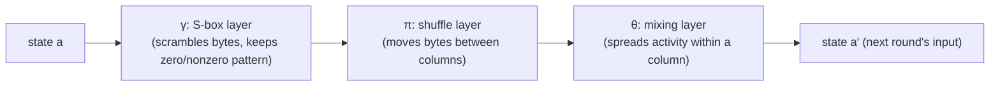
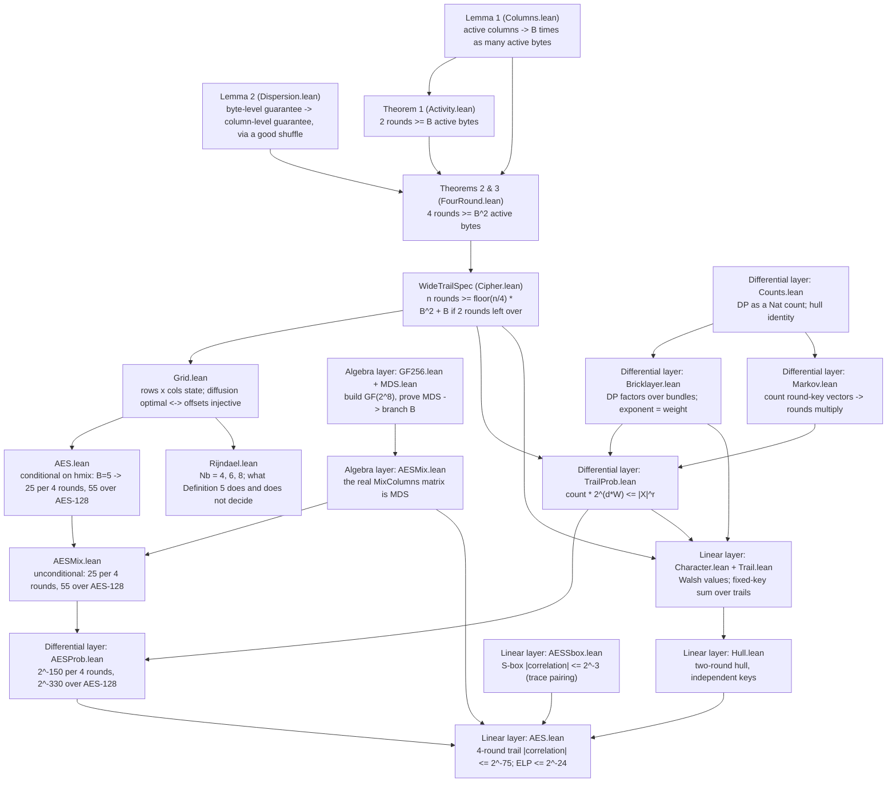

# WideTrail

*Kernel-checked wide-trail and HADES activity bounds, concrete AES algebra, exact differential trail counts, and linear trail correlations in Lean 4.*

Based on Daemen and Rijmen's [The Wide Trail Design Strategy](https://doi.org/10.1007/3-540-45325-3_20) (Cryptography and Coding 2001, LNCS 2260, pp. 222–238; see [`paper/`](paper/)).

---

## Building and checking

You need [elan](https://github.com/leanprover/elan), the Lean toolchain manager, and git.
The toolchain is pinned in [`lean-toolchain`](lean-toolchain) (Lean `v4.33.1`) and Mathlib in
[`lakefile.toml`](lakefile.toml) (`v4.33.1`); elan and Lake fetch both.

```bash
git clone https://github.com/4waan/Wide-Trail-formal-verification.git
cd Wide-Trail-formal-verification
lake exe cache get    # prebuilt Mathlib files, instead of compiling Mathlib
lake build            # the default library WideTrail
```

A successful `lake build` means every theorem in the default library has been checked by
Lean's kernel. Two further checks run in CI:

```bash
lake env lean scripts/AuditAxioms.lean   # only propext, Classical.choice, Quot.sound
python3 scripts/check_imports.py         # every module is reachable from a library root
```

The default library leaves out three check modules that evaluate whole width-16 Poseidon2
permutations in the kernel. Each needs 7 to 12 GB of memory to elaborate, so they live in a
separate library, `WideTrailHeavy`. That library also holds `Linear/Field.lean`, the one module
that imports `Mathlib.Analysis` (about 3.4 GB, almost all of it that import). Lake builds independent modules in parallel, so build
them one at a time:

```bash
lake build WideTrail.Poseidon2.Checks.KoalaBear   # about 12 GB
lake build WideTrail.Poseidon2.Checks.BabyBear    # about 7 GB
lake build WideTrail.Poseidon2.Checks.Plonky3     # about 7 GB
lake build WideTrailHeavy
lake env lean scripts/AuditAxiomsHeavy.lean      # the audit with these checks included
```

No module of the default library measured above about 3.3 GB; the largest are
`Poseidon/StarknetCompressed.lean` and the Aztec automaton certificate
(`Poseidon2/Certificates/AztecBN254Automaton.lean`), at about 3.2 GB each. Lake runs one
Lean process per core, so the peak of the default build grows with the number of cores.

To cite this project, see [`CITATION.cff`](CITATION.cff).

---

## Named proof layers

The directories identify the kind of mathematics they contain: `Propagation`,
`Algebra`, `Differential`, `Hades`, `Poseidon2`, `Poseidon`, and `Linear`. The original numbered
directories have been renamed; import paths now use these names. Import a complete layer with
`import WideTrail.Propagation`, `import WideTrail.Algebra`,
`import WideTrail.Differential`, `import WideTrail.Hades`,
`import WideTrail.Poseidon2`, `import WideTrail.Poseidon`, or `import WideTrail.Linear`.

**Propagation layer** (`WideTrail/Propagation/`) is the abstract propagation theory: an S-box layer, a
shuffle, and a mixing layer, related only by the structural properties a wide-trail cipher
needs (support-preservation, diffusion optimality, a branch number). It's parametric, the
branch number, state size, and field are all just parameters, so it proves a bound for an
entire *family* of cipher shapes at once, AES included. Instantiated at the AES shape, it
gives `aes_four_round`/`aes128_ten_round` as an **implication**: *given* that MixColumns has
branch number `5`, four rounds force `25` active S-boxes and the ten rounds of AES-128 force
`55`. The `hmix`/`hnd` hypotheses in `Propagation/AES.lean` are exactly that "given."

The state is rectangular, `Fin rows × Fin cols`, not square, so the whole Rijndael family is
in range: `Propagation/Rijndael.lean` covers the 192- and 256-bit block sizes as well, and uses
them to test what the theory actually decides about a real design choice.

**Algebra layer** (`WideTrail/Algebra/`) discharges that hypothesis. It builds `GF(2⁸)` from scratch
(Mathlib's `GaloisField` is `noncomputable`, unusable for the enumeration this needs), proves
the general "MDS matrix ⟹ optimal branch number" theorem, vocabulary Mathlib doesn't have at
all, and instantiates both against the real `4×4` AES `MixColumns` matrix. The output is
`Algebra/AESMix.lean`'s `aes_four_round_concrete`/`aes128_ten_round_concrete`: the same two
bounds, now with *no* remaining hypothesis except the free fact that the S-box layer is a
bijective bricklayer (true for any invertible S-box, AES's included). The same layer holds
the linear algebra of the Poseidon2 layers over any field: Plonky3's `4×4` matrix, the
block-circulant external layer and its branch number, the internal layer `c (diag d + J)`,
and their transposes.

**Differential layer** (`WideTrail/Differential/`) turns the count into a probability. A differential's
probability is kept as a `Nat` numerator over a fixed denominator, never a rational, so
every statement stays exact and stays decidable on a small cipher. Three steps: a
bricklayer's differential count factors over bundles, and the number of factors that are not
free is exactly Propagation layer's `weight`; the rounds multiply; and `4 · 2⁶ = 256` turns each active
AES S-box into a factor of `2⁻⁶`. Out comes `2⁻¹⁵⁰` over four rounds and `2⁻³³⁰` over the ten
rounds of AES-128.

The multiplication step is the one that needs an assumption, and Differential layer does not assume the
product formula. It counts pairs of an input and a **round-key vector**, so independent round
keys are visible in what is being counted, and then *proves* the product. That is not a
stylistic preference: assuming the product formula at a fixed key is inconsistent for
ten-round AES, and `Differential/Checks/Toy.lean` exhibits a cipher, a trail and a key where
the key-averaged count is positive and the fixed-key count is zero. Differential layer also proves,
unconditionally, that a differential is a *sum* over trails and exhibits a two-round
differential worth twice its best trail, which is the hull effect that caveats every
wide-trail figure in the literature. `Differential/Hull.lean` then bounds the differential
itself, the whole sum, in the same independent-key model: over two bricklayer rounds with
bijective S-boxes of uniformity at most `u` and a first linear layer of branch number at
least `B`, every differential with a nonzero input difference has key-averaged
probability at most `(u / |K|)^(B - 1)` (`Scheduled.bricklayer_two_round_bound`). Only
those two rounds are charged, and the bound concerns the keys averaged over:
`Differential/Checks/Hull.lean` gives a toy cipher on which it fails with the keys fixed
to zero.

Differential layer also demotes one of Propagation layer's hypotheses to a theorem. `PreserveSupport` was a claim
about a function on differences, and a real S-box layer has no such function; what it really
guarantees is that any output difference it *can* produce has the same support as the input.
Differential layer proves that from injectivity alone, and Propagation layer's four-round theorems were generalised
to consume it, with the old function-shaped statements surviving unchanged as corollaries.

**Hades layer** (`WideTrail/Hades/`) models full and partial S-box rounds with fixed
additions and round-specific invertible linear maps. It counts active coordinates
only where an S-box is actually applied. For `r` full rounds, `m` partial rounds,
and `s` full rounds, its execution theorem gives
`(r / 2 + s / 2) * B + r % 2 + s % 2` active S-boxes from the outer blocks.
Whole-state MDS mixing supplies `B = t + 1`. The activity result applies to actual pairs of
distinct inputs. `Counting.lean` and `Probability.lean` now connect masked activity
to exact differential trail counts in the explicitly independent-key model.
`Subspace.lean` charges the middle rounds too: when no nonzero difference stays
off the S-box coordinates through `w` consecutive partial rounds with the internal
linear map, the `m` middle rounds add `m / w` active S-boxes (`outer_middle_bound`), and the
same term enters the probability bridge (`hades_probability_with_middle`). Fewer
than `width / mask size` rounds always leave a nonzero inactive difference
(`inactiveSpace_ne_bot`). The trail bounds also keep the ratio `|K| / u` per charged
S-box exact (`hades_probability_exact`, `hades_probability_with_middle_exact`).
`Dimension.lean` gives the exact dimensions of the inactive spaces: with one S-box
coordinate, once no nonzero difference stays inactive through `width` consecutive
partial rounds, each round removes exactly one dimension
(`finrank_inactiveSpace_singleton`), and for the Poseidon2 internal layer
`c (diag d + J)` that happens exactly when the diagonal entries off the S-box
coordinate are pairwise distinct (`inactiveSpace_diagPlusOnes_card_eq_bot_iff`).
`Hull.lean` bounds a key-averaged differential, not only a trail, over two full rounds
(`hades_differential_bound`).
`MiddleBound.lean` takes any lower bound on the partial rounds as a hypothesis,
`MiddleBound A mask m μ` (every trail through `m` consecutive partial rounds with linear map `A`,
from a nonzero difference, charges at least `μ` S-boxes), and adds it to the outer count and to
the trail bounds (`outer_middle_bound_of`, `hades_probability_with_middle_bound_exact`); the
window argument is the case `μ = m / w`. Larger bounds come from finite certificates for a
concrete matrix: window relations, linear relations between the S-box differences of
consecutive rounds that refute every activity pattern with too few active rounds
(`WindowRelation.lean`, `MiddleBound.of_relationCheck`), and forward-space automata with a
potential (`Automaton.lean`, `MiddleBound.of_automatonCheck`). Boolean checkers on lists of
natural numbers (`RelationCheck.lean`, `AutomatonCheck.lean`) let the kernel check a certificate
by `decide +kernel` on light imports. These are lower bounds in the `IsTrail` model, which
records only supports, masks and linear maps.
See [the HADES mechanics](MECHANICS_HADES.md) and [the implementation plan](HADES_PLAN.md).

**Poseidon2 layer** (`WideTrail/Poseidon2/`) certifies the pinned reference BN254
width-three instance: field primality, the actual fifth-power S-box, both linear
inverses, external MDS mixing, permutation bijectivity, and at least 34 active
S-boxes per distinct input pair, 16 from the outer rounds and 18 from the partial
rounds. Its checked execution traces match the pinned upstream known-answer vector
and the vector of SP1's gnark test for the same permutation, which SP1 uses for its
outer recursion and wrap stages. It also certifies the two width-sixteen
permutations SP1 uses for its main proof system, through one generic model of the
Plonky3 code: KoalaBear (SP1 6.10.0, `x^3`, twenty partial rounds) with at least 33
active S-boxes per distinct input pair, and BabyBear (SP1 5.2.4, `x^7`, thirteen
partial rounds) with at least 32. For each instance the independent-key trail bound is
also stated as an exact ratio, which gives the exponents 989 (KoalaBear), 906 (BabyBear)
and 8554 (BN254), each the largest this arithmetic allows; a key-averaged differential
bound charges the first two full rounds. All of these concern one trail, or the
differential averaged over an additional independent uniform key per round, not the
permutation with its fixed constants. The models of both width-sixteen instances
reproduce the known-answer vectors of the upstream `p3-koala-bear` and `p3-baby-bear`
crates, with those tests' own round constants. The width-sixteen model takes the
internal diagonal and its scale as parameters, so the same proofs also certify two
other deployed permutations: Pico v3.2.0's KoalaBear permutation (at least 33 active
S-boxes, trail exponent 989, or 957 with whole bits per S-box) and OpenVM v2.1.0's BabyBear
permutation (at least 32, exponent 906, or 896 with whole bits). Each of these reproduces a known-answer vector from Plonky3's
own tests that uses the deployed round constants.
Certificates for the partial rounds raise three of these counts, as lower bounds, with the
earlier theorems unchanged: every trail through the twenty partial rounds of SP1's and Pico's
KoalaBear permutations charges at least 3 S-boxes, so every distinct input pair incurs at least
35 (trail exponent 1049, or 1015 with whole bits per S-box), and every trail through the 56 partial
rounds of the BN254 width-three permutation charges at least 27, so every trail in the `IsTrail`
model through its 64 rounds, and every distinct input pair, incurs at least 43 (exponent 10818,
or 10793 with whole bits), a total that some trail in the `IsTrail` model attains. BabyBear's thirteen partial
rounds, fewer than its width, still add nothing.
The layer also certifies the width-four BN254 permutation of Aztec's barretenberg
(aztec-packages v1.0.0 and v6.1.0) and of Noir v1.0.0: HorizenLabs' `4×4` matrix as the external
layer, MDS over BN254 with branch number exactly 5, the internal layer `diag(d) + J`, and
`4 + 56 + 4` rounds. Every distinct input pair incurs at least 34 charged S-boxes by windows of
four partial rounds, and at least 44 with a certificate for windows of fourteen; with the exact
ratio the trail exponents are 8554 for 34 and 11070 for 44, and the two-round differential
exponent is 1006. The model reproduces the published known-answer vectors of barretenberg,
bb.js and Noir, seven distinct inputs. Like those above, these exponents concern one trail, or
the differential, with an additional independent uniform key per round.
See [the concrete certificates and their scope](PRODUCTION_CERTIFICATE.md).

**Poseidon layer** (`WideTrail/Poseidon/`) certifies the original Poseidon, the HADES design,
as Starknet deploys it: the STARK field `p = 2^251 + 17 · 2^192 + 1`, with primality by Lucas
certificates, width three, `x^3`, `4 + 83 + 4` rounds, one matrix
`M = [[3, 1, 1], [1, -1, 1], [1, 1, -2]]` in every round, no linear layer before the first
round, and the partial-round S-box on coordinate 2. With no remaining premise: bijectivity; `M`
is MDS, with branch number exactly 4, and equals `diag(2, -2, -3) + J`; at least 16 charged
S-boxes per distinct input pair from the full rounds and 43 with windows of three partial
rounds; and, from a forward-space automaton certificate for the 83 partial rounds, at least 57,
a total that some trail in the `IsTrail` model attains. The trail exponents are 4000, 10750 and
14250; keeping the ratio `p / 2` exact gains nothing, since `p` is barely above `2^251`. The
two-round differential exponent is 750. The compressed schedule of 107 constants that most
implementations run is proved to compute the same permutation for every input, and to give the
same state when the same additional key is added to both schedules. The model reproduces the
three permutation-level known-answer vectors that the sources publish (pathfinder and
CryptoExperts, lambdaworks and starknet-types-core, the Cairo corelib). As for Poseidon2, the
probability statements concern one trail, or the differential averaged over an additional
independent uniform key per round, not the permutation with its fixed constants.

**Linear layer** (`WideTrail/Linear/`) is the correlation side. A correlation is kept as its
numerator, the Walsh value `walsh ψ P Q F u v = ∑ₓ ψ (⟨v, F x⟩ - ⟨u, x⟩)`, for a pairing
`⟨u, x⟩` of masks with states and an additive character `ψ`; in the binary case it is an
integer, as a differential count is a natural number. The pairing is part of every statement:
AES is treated under the trace pairing `⟨u, x⟩ = ∑ᵢ Tr(uᵢ xᵢ)` of `GF(2⁸)`, under which a field
matrix moves masks through its field transpose, and not under the bit pairing. Masks are
propagated forward through the inverse of the adjoint, so a sequence of masks with a nonzero
correlation is a `WideTrailSpec.IsTrail`, or a `Hades.IsTrail`, of the forward mask map, and the
activity theorems above apply to it unchanged. A trail's correlation involves no key: for every
key vector the cipher's Walsh value is a sum over trails with key-dependent phases
(`walsh_run_eq_sum_trails`), and the key enters each summand only through its phase (a sign `±1`
in the binary case). A trail bound therefore bounds one summand of the fixed-key correlation,
the same in magnitude for every key; it is not a bound on the cipher's correlation for a fixed
key. The hull, the squared correlation averaged over an additional independent uniform key per
round, is the sum of the squared trail correlations (Nyberg's identity,
`elpCount_succ_eq_sum_trails`) and is bounded over two rounds from the branch number of the
backward map (`elpCount_two_round_bound`).

For AES the S-box obligation is discharged: under the trace pairing every Walsh value of the
S-box at a nonzero input mask is at most `32` in absolute value, so every such correlation is at
most `2⁻³`, and `32` is attained (`AES.sbox_isLinearityBound`, `AES.sbox_isLinearityBound_iff`).
The `255 · 256` Walsh values with a nonzero output mask are reduced to one spectrum of 256
values, which the kernel checks on natural numbers; at the zero output mask and a nonzero input
mask the value is `0`. With the branch number `5`, every 4-, 10-, 12- and 14-round linear trail
with a nonzero input mask has a trail correlation of at most `2⁻⁷⁵`, `2⁻¹⁶⁵`, `2⁻²²⁵` and
`2⁻²⁴⁰` in absolute value (at least 25, 55, 75 and 80 active S-boxes for every such trail with a
nonzero correlation), and the expected linear probability over two rounds, and over any `R ≥ 2`
rounds, is at most `2⁻²⁴` for every nonzero input mask in the independent-key model. The bit
pairing is not treated, so the designers' four-round bound for bit masks is not proved. For the
Poseidon and Poseidon2 instances, every linear trail with a nonzero input mask and a nonzero
correlation (for Poseidon2, a trail of the rounds after the initial external layer) charges at
least the same number of S-boxes as the differential lower bounds (33 and 35, 32, 34 and 43, 34
and 44, 43 and 57); their trail bounds take the S-box correlation bound as a hypothesis, since no
bound on a Walsh value of `x ↦ x^d` over a prime field (such as the Weil bound) is proved. See
[the linear mechanics](MECHANICS_LINEAR.md).

Named theorem footprints are pinned by `#print axioms`. The complete module audit in
`scripts/AuditAxiomsHeavy.lean` checks every project declaration (9254 at this revision),
including names in the root namespace (`scripts/AuditAxioms.lean` does the same for the 7097
declarations of the default library). Both allow nothing beyond the standard
`propext, Classical.choice, Quot.sound` baseline: no `sorry`, no `native_decide`, no
`bv_decide` fallback axiom, anywhere. See
[`WideTrail/Algebra/MDS_HYPOTHESIS_BUILD.md`](WideTrail/Algebra/MDS_HYPOTHESIS_BUILD.md) for the
build log of Algebra layer (what was tried, what failed, why),
[`MECHANICS_ALGEBRA.md`](MECHANICS_ALGEBRA.md) for how the algebra works,
[`MECHANICS_PROPAGATION.md`](MECHANICS_PROPAGATION.md) for the support argument,
[`MECHANICS_DIFFERENTIAL.md`](MECHANICS_DIFFERENTIAL.md) for the same on Differential layer, and
[`MECHANICS_LINEAR.md`](MECHANICS_LINEAR.md) for the same on Linear layer.

---

## What's in each file

The files import each other in this order, each one building on the last.

### [`WideTrail.lean`](WideTrail.lean)
The entry point. It just imports every file below, so the whole library is one `import WideTrail` away.

### Propagation layer: the abstract theory

#### [`WideTrail/Propagation/Activity.lean`](WideTrail/Propagation/Activity.lean)
The foundation. Defines what it means for a position in the cipher's state to be "active" (its difference is nonzero), counts how many positions are active (the *weight*), and proves the basic two-round bound: across any two rounds, the number of active positions is at least the branch number of the mixing layer.

#### [`WideTrail/Propagation/Columns.lean`](WideTrail/Propagation/Columns.lean)
Groups the state into columns, the way AES groups bytes into 4-byte columns, and proves that if the mixing layer guarantees a minimum spread within each column, that spread adds up: any set of active columns forces that many times more active bytes overall (**Lemma 1**).

#### [`WideTrail/Propagation/Dispersion.lean`](WideTrail/Propagation/Dispersion.lean)
Models the shuffle step (like ShiftRows) that scrambles which column each byte belongs to between rounds. Proves that if this shuffle is "diffusion optimal", meaning no two bytes from the same column ever end up sharing a column again, then a column-level guarantee can be upgraded into a stronger bundle-level one (**Lemma 2**).

#### [`WideTrail/Propagation/FourRound.lean`](WideTrail/Propagation/FourRound.lean)
Combines Lemma 1 and Lemma 2 into the paper's two headline theorems: any four consecutive rounds of a wide-trail cipher force at least `B²` active S-boxes, where `B` is the branch number of the mixing layer. It's proved for both of the paper's cipher shapes, to show they agree.

#### [`WideTrail/Propagation/Cipher.lean`](WideTrail/Propagation/Cipher.lean)
Packages a whole cipher design (its column layout, S-box, shuffle, mixing layer, and the proof obligations they must satisfy) into a single structure, `WideTrailSpec`. Also extends the four-round theorem to any number of rounds by chaining four-round blocks together.

#### [`WideTrail/Propagation/Grid.lean`](WideTrail/Propagation/Grid.lean)
Instantiates the abstract theory on a rectangular `rows × cols` state with ShiftRows at an arbitrary offset vector. The whole file turns on one equivalence: the paper's geometric "diffusion optimal" condition on a permutation of `rows · cols` positions is *exactly* injectivity of the offset vector. That collapses a design criterion into something the kernel can decide for any concrete candidate, count in closed form, and refute. It also proves, for every possible shuffle and not just rotations, that a state with more rows than columns admits no diffusion-optimal shuffle at all.

#### [`WideTrail/Propagation/AES.lean`](WideTrail/Propagation/AES.lean)
Plugs the real AES shape into `WideTrailSpec`: the square case of the grid, ShiftRows as the shuffle, and a MixColumns with branch number 5 (a property of AES that's taken as a hypothesis here, `hmix`/`hnd`, rather than re-derived from finite-field arithmetic; Algebra layer is what discharges it). Out comes the actual numbers: at least 25 active S-boxes over any four rounds, 55 over the ten rounds of AES-128, 75 over the twelve of AES-192, and 80 over the fourteen of AES-256.

#### [`WideTrail/Propagation/Rijndael.lean`](WideTrail/Propagation/Rijndael.lean)
Rijndael at all three block sizes, and the place where the formalization is asked to rule on a real design decision. Rijndael shifts its rows by `0,1,2,3` at 128- and 192-bit blocks but by `0,1,3,4` at 256 bits. The kernel's verdict on the natural explanation is *no*: `0,1,2,3` is diffusion-optimal on the wide state too, along with 1678 other offset vectors, so the wide-trail criterion is not what rejected it. The criterion is not vacuous either, the 256-bit offsets are illegal on the AES state, and a 4×3 state admits no diffusion-optimal shuffle whatsoever.

#### [`WideTrail/Propagation/Checks/Verification.lean`](WideTrail/Propagation/Checks/Verification.lean)
A sanity-check file, not a source of new results. It builds a toy cipher to show the theorems' assumptions can all hold at once (so nothing here is vacuously true), and builds a second toy cipher that is missing only the "diffusion optimal" shuffle property to show the bound genuinely breaks without it.

#### [`WideTrail/Propagation/Checks/Tightness.lean`](WideTrail/Propagation/Checks/Tightness.lean)
Measures how much slack is in the bounds on the one cipher small enough to search exhaustively (`toySpec`, a `2×2` state over `GF(2)`): the two-round bound turns out exactly tight, the four-round bound looser.

#### [`WideTrail/Propagation/Checks/Axioms.lean`](WideTrail/Propagation/Checks/Axioms.lean)
Audits the axiom footprint of the toy-cipher checks: confirms every finite check in the project runs through kernel `decide`, never `native_decide`, so nothing here quietly moved trust out of the kernel.

### Algebra layer: discharging MixColumns

#### [`WideTrail/Algebra/GF256.lean`](WideTrail/Algebra/GF256.lean)
`GF(2⁸)` built from scratch as `BitVec 8` under xor and shift-and-reduce multiplication, proved a genuine `Field`, commutativity and associativity by bilinear extension from a 64/512-case basis check (not brute force, which hits a kernel recursion-depth wall well before it could finish), inverses by an unrolled Fermat exponentiation.

#### [`WideTrail/Algebra/MDS.lean`](WideTrail/Algebra/MDS.lean)
The general theorem: if every square submatrix of a matrix `M` is nonsingular (the MDS property), then `{(x, Mx)}` has the optimal branch number `n+1`, vocabulary Mathlib has none of (no MDS matrices, no minimum distance, no Singleton bound anywhere in the library).

#### [`WideTrail/Algebra/AESMix.lean`](WideTrail/Algebra/AESMix.lean)
The real `4×4` AES `MixColumns` matrix over `GF256`, proved MDS (all 69 minors nonsingular), and wired through Propagation layer's `aes_four_round`/`aes128_ten_round` to produce the fully unconditional `aes_four_round_concrete`/`aes128_ten_round_concrete` (25 and 55), plus the same for AES-192 and AES-256 (75 and 80).

#### [`WideTrail/Algebra/AESSbox.lean`](WideTrail/Algebra/AESSbox.lean)
The FIPS 197 byte substitution: inversion in `GF(2⁸)` followed by the binary affine map with constant `0x63`, an executable inverse, and a proof of bijectivity.

#### [`WideTrail/Algebra/PowerSbox.lean`](WideTrail/Algebra/PowerSbox.lean)
A power map `x ↦ x^e` as an executable equivalence with inverse `x ↦ x^d`, whenever `e d = (q - 1) k + 1` and every nonzero `x` satisfies `x^(q - 1) = 1` (`Sbox.powerEquivOfFermat`). No enumeration of the field is needed.

#### [`WideTrail/Algebra/MDS4.lean`](WideTrail/Algebra/MDS4.lean)
Plonky3's `4×4` matrix `circ(2, 3, 1, 1)` over any field. It is MDS exactly when `2, 3, 5, 7, 11` and `17` are nonzero (`m4_isMDS_iff`), so its branch number is then at least `5` (`m4_isBranchBound`). Its determinant is `-35`, which gives an explicit inverse.

#### [`WideTrail/Algebra/BlockCirculant.lean`](WideTrail/Algebra/BlockCirculant.lean)
The Poseidon2 external layer as a block circulant `circ(2N, N, …, N)`: block `i` of the output is `N (xᵢ + ∑ⱼ xⱼ)`. If `N` has branch number `p + 1` on blocks of size `p`, and `1, …, b + 1` are nonzero for `b` blocks, the whole layer has branch number at least `min(b + p, 2(p + 1))`. At width sixteen that is `8`. The checks show the characteristic hypothesis cannot be dropped, and that the bound is attained in a small case over `ZMod 7`. On states whose blocks sum to zero the layer applies `N` to each block with no mixing between blocks (`blockMix_of_blockSum_eq_zero`); these states form a subspace of dimension `(b - 1) p` (`finrank_blockSumZero`), and when `N` is injective and `b + 1 ≠ 0` a state lies in it exactly when its image does (`blockMix_mem_blockSumZero_iff`). These are facts about the linear map alone, not about any attack.

#### [`WideTrail/Algebra/DiagPlusOnes.lean`](WideTrail/Algebra/DiagPlusOnes.lean)
The Poseidon2 internal layer `c (diag d + J)` as a linear equivalence, with the Sherman–Morrison inverse. It needs `c ≠ 0`, every `dᵢ ≠ 0` and `1 + ∑ 1/dᵢ ≠ 0`. The map is self-adjoint for the dot product, which `Hades/Krylov.lean` uses.

#### [`WideTrail/Algebra/Transpose.lean`](WideTrail/Algebra/Transpose.lean)
Transposes of the Poseidon2 linear layers. A square matrix is MDS exactly when its transpose is; the transpose of `circ(2, 3, 1, 1)` is `circ(2, 1, 1, 3)`, MDS under the same hypothesis; the transpose of `circ(2A, A, …, A)` is `circ(2Aᵀ, Aᵀ, …, Aᵀ)`, and at width sixteen it has branch number at least `8`; `c (diag d + J)` is symmetric. Taking the linear branch number of a map to be the differential branch number of its transpose, a definition here and not a proved statement about correlations, the differential branch-number bounds carry over. This file proves no correlation, linear trail or linear-attack bound. The identification it takes as a definition is proved in `Linear/Masks.lean` for a separating pairing (`Linear.isLinBranchBound_iff`): over `F_p`, with the dot product and a separating character, it holds as stated, and the external layer has linear branch number at least `8` through correlations (`Poseidon2.Plonky3.external_isLinBranchBound`). Under bit masks on `GF(2⁸)` the nonzero correlations of `x ↦ A x` need not be the pairs `(Aᵀ v, v)`, since the bit adjoint of a field matrix need not be its field transpose (for the `MixColumns` matrix it is not). Because the relabelling of masks between the trace and bit pairings acts byte by byte, the branch number would carry over, but that needs the relabelling to be a bijection, which is not proved, so nothing is claimed for bit masks (see [the linear mechanics](MECHANICS_LINEAR.md#2-the-pairing-is-part-of-the-statement)). The file's own docstring, which predates the linear layer, still says that correlations and this identification are not formalised.

#### [`WideTrail/Algebra/Checks/`](WideTrail/Algebra/Checks/)
`MDS4.lean` shows over `ZMod 11` and `ZMod 7` that `circ(2, 3, 1, 1)` fails to be MDS when `11` or `7` vanishes, and that branch number `5` is attained over `ZMod 13`; the HorizenLabs matrix it records as different is treated in [`Poseidon2/HorizenLabsM4.lean`](WideTrail/Poseidon2/HorizenLabsM4.lean). `BlockCirculant.lean` shows that the characteristic hypothesis of the block-circulant bound cannot be dropped and that the bound is attained. `Axioms.lean` pins the axiom footprints of the layer's results.

### Differential layer: from active S-boxes to a probability

#### [`WideTrail/Differential/Counts.lean`](WideTrail/Differential/Counts.lean)
What a differential probability is, without measure theory: `diffCount F a b` counts the inputs realising the differential, and `DP ≤ 2⁻ᵈ` is written `diffCount * 2 ^ d ≤ |X|`, exact in `ℕ` and decidable. Proves that a row of the difference distribution table sums to `|X|`, that round keys and invertible linear layers change no count, and the hull identity: the differential of a composition is a *sum* over intermediate differences, unconditionally.

#### [`WideTrail/Differential/Bricklayer.lean`](WideTrail/Differential/Bricklayer.lean)
The join between the two halves of the project. A bricklayer's differential count factors over bundles, and splitting that product over the support gives `u ^ weight a * |K| ^ (|Idx| - weight a)`: Propagation layer's `weight` appears as an exponent with no translation step. Also proves the support-preservation that Propagation layer had to assume, from injectivity of the S-boxes alone.

#### [`WideTrail/Differential/Markov.lean`](WideTrail/Differential/Markov.lean)
The Markov cipher model, with the assumption in the shape of what is counted rather than in a hypothesis: the count ranges over round-key vectors, so independent round keys are explicit, and the product formula is then a theorem. Proved by peeling one round at a time, which is the change of variables `yₙ = xₙ + kₙ` in disguise.

#### [`WideTrail/Differential/TrailProb.lean`](WideTrail/Differential/TrailProb.lean)
The arithmetic, once: `trailKeyCount · 2 ^ (d·W) ≤ |X| ^ r`. Plus the bridge that lets Propagation layer count a real differential trail, since a trail with a nonzero count satisfies `WideTrailSpec.IsTrail`.

#### [`WideTrail/Differential/AESProb.lean`](WideTrail/Differential/AESProb.lean)
The numbers. `|K| = 256`, `|Idx| = 16`, S-box uniformity `4`, and `4 · 2⁶ = 256`, so each active S-box costs `2⁻⁶`: `2⁻¹⁵⁰` over four rounds, `2⁻³³⁰` over ten, `2⁻⁴⁵⁰` over twelve, `2⁻⁴⁸⁰` over fourteen. The generic theorem retains explicit S-box hypotheses. `AESConcrete.lean` now discharges them for the actual AES S-box, using its proved inverse and a structural differential-uniformity proof.

#### [`WideTrail/Differential/Polynomial.lean`](WideTrail/Differential/Polynomial.lean), [`WideTrail/Differential/AESConcrete.lean`](WideTrail/Differential/AESConcrete.lean)
Differential bounds from polynomial root counts, with no enumeration of the field: apart from two exceptional inputs, a differential solution of inversion is a root of a nonzero quadratic. `AESConcrete.lean` carries this through the AES affine map, proves that the count `4` is attained, and discharges the S-box hypotheses of the AES trail bounds.

#### [`WideTrail/Differential/Scheduled.lean`](WideTrail/Differential/Scheduled.lean)
The Markov product formula for round-specific nonlinear and linear maps, counted over independent round-key vectors, which the Hades layer uses.

#### [`WideTrail/Differential/Hull.lean`](WideTrail/Differential/Hull.lean)
Differentials, not trails, in the additional-independent-key model. `diffKeyCount` counts the key vectors under which an input pair reaches a given output difference; it does not depend on the input (`diffKeyCount_const`), composes as a sum over intermediate differences (`diffKeyCount_add`), and over `r + 1` rounds is the sum of the trail counts of all trails from `a` to `b` (`diffKeyCount_succ_eq_sum_trailKeyCount`). The two-round bound: for bricklayer rounds with bijective S-boxes of uniformity at most `u` and a first linear layer of branch number at least `B`, `diffKeyCount * |K|^(B - 1) ≤ u^(B - 1) * |Idx → K|^2` for every nonzero input difference (`diffKeyCount_two_round_bound`, `bricklayer_two_round_bound`), and the same ratio over any number of bijective rounds containing two such rounds (`diffKeyCount_bound_of_two_rounds`). Only two rounds are charged, and nothing is said about a fixed key or fixed round constants.

#### [`WideTrail/Differential/PowerMap.lean`](WideTrail/Differential/PowerMap.lean)
The power map `x ↦ x^d` over any field has differential uniformity at most `d - 1` when `d` is nonzero in the field: for a nonzero input difference, the equation is a polynomial of degree `d - 1`. The checks show the bound is attained for `x^3` over `ZMod 7` and `x^7` over `ZMod 29`, and fails over `ZMod 3`, where `3 = 0`.

#### [`WideTrail/Differential/Checks/Toy.lean`](WideTrail/Differential/Checks/Toy.lean)
A sixteen-state cipher the kernel enumerates in full. Recomputes the bundle product and the Markov product by brute force, shows the S-box uniformity constant is exactly attained, exhibits a fixed key under which the product formula is false, and exhibits a two-round differential worth twice its best trail.

#### [`WideTrail/Differential/Checks/PowerMap.lean`](WideTrail/Differential/Checks/PowerMap.lean)
The power-map bound is attained for `x^3` over `ZMod 7` and for `x^7` over `ZMod 29`, and its conclusion fails without its hypotheses: over `ZMod 3`, where `3 = 0`, and for `d = 1`.

#### [`WideTrail/Differential/Checks/Hull.lean`](WideTrail/Differential/Checks/Hull.lean)
The two-round bound on a twenty-five-state cipher over `ZMod 5`: it allows `100` of the `625` key pairs, and the kernel finds a maximum of `85` over all differentials with a nonzero input difference (`toy_count_le`, `toy_count_max`). With both keys fixed to zero, one differential is realised by `5` of the `25` inputs, above the bound (`toy_fixed_exceeds`): the bound is a statement about the key-averaged model only.

#### [`WideTrail/Differential/Checks/Axioms.lean`](WideTrail/Differential/Checks/Axioms.lean)
The same axiom audit as Propagation layer, applied to the probability layer: twenty-six results, all on the standard baseline, none through `native_decide`.

---

### Hades layer: scheduled full and partial rounds

#### [`Masked.lean`](WideTrail/Hades/Masked.lean)
Defines masked coordinate S-boxes and `sboxWeight`, the charged activity. Proves
bijectivity, support preservation for actual input pairs, and exact propagation
through identity coordinates.

#### [`Schedule.lean`](WideTrail/Hades/Schedule.lean)
Defines executable pre-addition rounds, their inverses, finite executions, and
actual difference traces. A full/partial/full schedule has explicit lengths and
proved boundaries. Round additions remain deterministic parameters.

#### [`Bounds.lean`](WideTrail/Hades/Bounds.lean)
Proves shifted full-window bounds and `outerRound_bound`. Pairs of full rounds
cost a branch bound; an odd remaining full round costs one. The two outer blocks
are counted separately. `hades_mds_bound` supplies the whole-state MDS corollary.

#### [`Counting.lean`](WideTrail/Hades/Counting.lean), [`Probability.lean`](WideTrail/Hades/Probability.lean)
`Counting.lean` factors the exact differential count of a masked S-box layer; identity
coordinates are never charged. `Probability.lean` connects charged activity to trail
counts in the model with an additional independent uniform key per round: a trail with a
nonzero count is a support-correct trail, and `hades_probability` charges `d` bits per
charged S-box when `u * 2^d ≤ |K|`. `hades_probability_exact` keeps the ratio `|K| / u`
exact instead, and `mul_le_of_ratio` turns such a ratio into a power of two. These bound
one trail, not the permutation with its fixed constants.

#### [`Subspace.lean`](WideTrail/Hades/Subspace.lean)
Shows that an inactive round acts on the difference by its linear map alone, so the
differences that stay inactive through `r` consecutive partial rounds form a subspace.
If that subspace is trivial, every window of `r` middle rounds activates an S-box;
differences inside it cross the window for free. Combines the outer and middle counts,
carries them into the independent-key trail bound, and proves by rank-nullity that too
short a window always leaves a nonzero inactive difference.

#### [`Krylov.lean`](WideTrail/Hades/Krylov.lean)
Turns "no nonzero difference stays off the S-box coordinate through `r` consecutive
partial rounds" into finite checks. For a self-adjoint internal map, the conditions are
dot products with the vectors `Lʲ e₀`. A table of those vectors and a left inverse, both
checked by `decide`, prove the inactive space trivial. A nonzero scalar in front of the
map does not matter.

#### [`Dimension.lean`](WideTrail/Hades/Dimension.lean)
How the inactive space shrinks as the window grows, for any linear map and mask. The
chain of spaces is constant from `width` rounds on (`inactiveSpace_eq_card`), and the
space for `width` rounds is the largest `L`-invariant subspace of differences inactive in
one round; it is trivial exactly when no nonzero difference stays inactive forever
(`no_infinite_inactive_trail`). With one S-box coordinate, if that space is trivial the
differences that stay inactive through `r` consecutive partial rounds have dimension
exactly `width - r` (`finrank_inactiveSpace_singleton`). For the Poseidon2 internal layer
`c (diag d + J)`, the space for `width` rounds is trivial exactly when the diagonal entries
off the S-box coordinate are pairwise distinct
(`inactiveSpace_diagPlusOnes_card_eq_bot_iff`), which needs no table, and the dimensions
are then exactly `width - r` (`finrank_inactiveSpace_diagPlusOnes`). These concern
differences that avoid the partial-round S-boxes only, not subspace trails in general.

#### [`Hull.lean`](WideTrail/Hades/Hull.lean)
Bounds a differential, the sum over all trails from `a` to `b`, through the scheduled
rounds in the additional-independent-key model. If two adjacent rounds are full, their
S-boxes have uniformity at most `u`, and the first has a linear layer of branch number at
least `B`, then every differential with a nonzero input difference has key-averaged
probability at most `(u / |K|)^(B - 1)` (`diffKeyCount_bound_of_two_full_rounds`,
`hades_differential_bound`). Only those two rounds are charged; nothing is said about the
fixed round constants alone.

#### [`MiddleBound.lean`](WideTrail/Hades/MiddleBound.lean)
Separates the count for the partial rounds from its proof. `MiddleBound A mask m μ` says that
every trail through `m` consecutive rounds with linear map `A` and that mask, from a nonzero
difference, charges at least `μ` S-boxes; it does not depend on the S-boxes or the round
constants. A bound applies inside a longer trail and bounds of adjacent windows add
(`MiddleBound.apply`, `MiddleBound.add`); the window argument is
`MiddleBound.of_inactiveSpace`; a nonzero scalar factor of `A` changes nothing
(`MiddleBound.smul_iff`, `MiddleBound.diagPlusOnes`). `outer_middle_bound_of` adds `μ` to the
outer count, and `hades_probability_with_middle_bound_exact` and
`hades_probability_with_middle_bound` carry it into the independent-key trail bound.

#### [`WindowRelation.lean`](WideTrail/Hades/WindowRelation.lean), [`RelationCheck.lean`](WideTrail/Hades/RelationCheck.lean)
Window relations. A chain of row vectors for `A` at the S-box coordinate gives one linear
relation between the S-box input and output differences of `D + 1` consecutive rounds
(`IsTrail.window_relation`). If no nonzero difference stays inactive through the `m` rounds and
every nonempty pattern of fewer than `k` active rounds is refuted by a combination of the
relations, every trail through them charges at least `k` (`MiddleBound.of_relations`).
`RelationCheck.lean` is the Boolean checker on lists of natural numbers over `ZMod p`, for
`A = diag d + J`; it imports only `Mathlib.Data.ZMod.Basic`. `MiddleBound.of_relationCheck`
turns a passing check into the bound `3`, and `MiddleBound.not_of_checkTrail` refutes a bound
with an explicit trail.

#### [`Automaton.lean`](WideTrail/Hades/Automaton.lean), [`AutomatonCheck.lean`](WideTrail/Hades/AutomatonCheck.lean)
Forward-space automata. Each state is a set of differences with a potential that drops by at
least one at every inactive round and grows by at most one at every active round; a valid
automaton for `m` rounds gives the bound `(m + 1 - pot start) / 2` (`MiddleBound.of_automaton`).
`AutomatonCheck.lean` is the Boolean checker, for any `t × t` matrix given by rows, with each
state a list of linear functionals; `MiddleBound.of_automatonCheck` combines the two.
`isTrail_of_checkHadesTrail` and `scheduledWeight_eq_trailWeight` check an explicit trail
through a whole schedule and compute its charged weight, which shows that a total is attained in
the `IsTrail` model.

#### [`Checks`](WideTrail/Hades/Checks/)
`Toy.lean`: a 25-state cipher over `ZMod 5` checks the count, exhibits a tight witness,
and shows why identity coordinates must be excluded. Weak mixing and a collapsing middle
map refute bounds stated without their required assumptions. `Counting.lean` checks the
masked and scheduled counts by enumeration. `Krylov.lean` checks the certificate route on a
four-coordinate internal matrix over `ZMod 13` and shows that self-adjointness cannot be
dropped. `Dimension.lean` shows over `ZMod 5` that a repeated diagonal entry leaves a
nonzero difference inactive forever, and that with a mask of two coordinates one round can
remove two dimensions. `MiddleBound.lean` re-derives the window theorems through the
middle-bound interface and shows on the `ZMod 5` toy layer that the predicate can fail.
`WindowRelation.lean` and `Automaton.lean` run both certificate kinds on the same toy: each
recomputes the window bound, a schedule of `2 + 4 + 2` rounds is charged at least 8 S-boxes,
attained, and changed certificates are rejected. `Axioms.lean` pins the axiom footprints.

---

### Poseidon2 layer: concrete permutations

#### [`BN254Parameters.lean`](WideTrail/Poseidon2/BN254Parameters.lean), [`BN254Primality.lean`](WideTrail/Poseidon2/BN254Primality.lean), [`BN254.lean`](WideTrail/Poseidon2/BN254.lean)
The reference BN254 width-three permutation: its 192 constants, primality by Lucas
certificates, the fifth-power S-box, both linear layers with inverses, bijectivity,
and 16 active S-boxes in the outer rounds.

#### [`BN254Middle.lean`](WideTrail/Poseidon2/BN254Middle.lean)
Charges the 56 internal rounds: no nonzero difference stays inactive through three
consecutive partial rounds, and some does through two, so every distinct input pair
incurs at least 34 active S-boxes. The internal matrix is `diag (1, 1, 2) + J`, so the
diagonal criterion proves the three-round statement again and gives exactly `3 - r`
inactive dimensions. The trail bound keeps the ratio `p / 4` exact, which gives the
exponent 8554, and a key-averaged differential bound charges the first two external
rounds (exponent 754).

#### [`BN254Execution.lean`](WideTrail/Poseidon2/BN254Execution.lean), [`BN254Checks.lean`](WideTrail/Poseidon2/BN254Checks.lean)
A materialised runner proved equal to the specification, a checked 64-round
trace, and the upstream `[0, 1, 2]` known-answer vector.

#### [`Checks/BN254SP1.lean`](WideTrail/Poseidon2/Checks/BN254SP1.lean)
SP1's gnark test vector for its BN254 outer permutation, input `(0, 0, 0)`, proved
for the same Lean permutation.

#### [`HorizenLabsM4.lean`](WideTrail/Poseidon2/HorizenLabsM4.lean)
HorizenLabs' `4×4` matrix `[[5, 7, 1, 3], [4, 6, 1, 1], [1, 3, 5, 7], [1, 1, 4, 6]]` over any
field, the external block of the HorizenLabs reference code, barretenberg and Noir; not
Plonky3's `circ(2, 3, 1, 1)`. Its determinant is `-64`, it has an explicit inverse when `2 ≠ 0`,
and it is MDS exactly when `2, 3, 5, 7, 11, 13, 19` and `23` are nonzero (`hlMat4_isMDS_iff`), so
its branch number is then at least `5` (`hlMat4_isBranchBound`), exactly `5` over BN254
([`Checks/AztecBN254.lean`](WideTrail/Poseidon2/Checks/AztecBN254.lean)).

#### [`AztecBN254.lean`](WideTrail/Poseidon2/AztecBN254.lean), [`AztecBN254Execution.lean`](WideTrail/Poseidon2/AztecBN254Execution.lean), [`Checks/AztecBN254.lean`](WideTrail/Poseidon2/Checks/AztecBN254.lean)
The width-four BN254 permutation of barretenberg (aztec-packages v1.0.0 and v6.1.0) and of
Noir v1.0.0: the BN254 field and `x^5`, `hlMat4` as the external layer, `diag(d) + J` as the
internal layer with the stored array `d` (the matrix's diagonal entries are `d_i + 1`), and
`4 + 56 + 4` rounds. Bijectivity; external branch number exactly 5; exactly `4 - r` inactive
dimensions; at least 20 charged S-boxes from the full rounds and 34 with the partial rounds;
trail exponent 8554 with the exact ratio, or 8534 with whole bits per S-box (5020 from the
full rounds alone); differential exponent 1006. The
runner transcribes the code's loop and addition chain and is proved equal to the specification.
The checks prove the published known-answer vectors of barretenberg, bb.js and Noir, seven
distinct inputs, and four negative controls: the transposed matrix, `diag(d + 1) + J`,
`diag(d - 1) + J`, and no initial layer.

#### [`Plonky3.lean`](WideTrail/Poseidon2/Plonky3.lean)
The width-sixteen Plonky3 permutation over any field. The external layer is proved
equal to a transcription of the code's `mds_light_permutation`. The internal layer
`c (diag d + J)` takes the diagonal `d` and the scale `c` as parameters
(`Plonky3.Diag`, under `Diag.Conditions d c`: `35 ≠ 0`, every `d i ≠ 0`,
`1 + ∑ 1/d i ≠ 0` and `c ≠ 0`). SP1's layer `R⁻¹ (diag d + J)` with SP1's diagonal is the
case `d = sp1Diag`, and its API is unchanged. Bijectivity, at least 32 active S-boxes
from the full rounds, the partial-round term, and the independent-key trail bound hold
for every diagonal, scale and round-constant table, the trail bound also as an exact
ratio. The diagonal criterion holds for every diagonal: no nonzero difference stays
inactive through sixteen consecutive partial rounds exactly when the entries off
coordinate 0 are pairwise distinct (`Diag.inactiveSpace_sixteen_eq_bot_iff`), and then
exactly `16 - r` dimensions stay inactive through `r ≤ 16` rounds
(`Diag.finrank_inactiveSpace_internal_eq`). Also: a key-averaged differential bound
over the first two full rounds, the states with zero block sum on which the external
layer acts block by block, and the transposes of both layers.

#### [`Plonky3Execution.lean`](WideTrail/Poseidon2/Plonky3Execution.lean)
A materialised runner for the width-sixteen permutation, with every coordinate a named
field and every layer written out coordinate by coordinate. It is proved equal to the
specification for every scale, S-box, constant table, number of partial rounds, input and
round count, so `decide` on the runner proves statements about the model. The runner
`Diag.permutationDense` does the same for every diagonal given as sixteen literals.

#### [`KoalaBear.lean`](WideTrail/Poseidon2/KoalaBear.lean), [`BabyBear.lean`](WideTrail/Poseidon2/BabyBear.lean)
The SP1 instances, with primality, the S-box, the Montgomery factor and the
pinned constants. KoalaBear: no nonzero difference stays inactive through sixteen
consecutive partial rounds, so at least 33 active S-boxes and a trail exponent of 989
(957 with whole bits per S-box). BabyBear: at least 32 and a trail exponent of 906 (896
with whole bits); its thirteen partial rounds add nothing, exactly 3 dimensions of differences stay
inactive through them, and some input pairs cross them without activating an S-box.
Both: the diagonal criterion, exactly `16 - r` inactive dimensions, and key-averaged
differential exponents 209 (KoalaBear) and 198 (BabyBear).

#### [`PicoKoalaBear.lean`](WideTrail/Poseidon2/PicoKoalaBear.lean), [`Checks/PicoKoalaBear.lean`](WideTrail/Poseidon2/Checks/PicoKoalaBear.lean)
Pico v3.2.0's permutation, `default_koalabear_poseidon2_16()` of the Brevis Plonky3 fork
(crate version 0.5.4). It has SP1's field, S-box, external layer and round constants
(`values_eq_sp1`) but a different internal layer: the fractional diagonal
`(-2, 1, 2, 1/2, 3, 4, -1/2, -3, -4, 1/2^8, 1/8, 1/2^24, -1/2^8, -1/8, -1/16, -1/2^24)`
with scale 1. At least 33 active S-boxes; trail exponent 989 with the exact ratio, or 957
with whole bits per S-box; differential exponent 209. `upstream_kat` reproduces Plonky3's
`test_default_koalabear_poseidon2_width_16`, which uses the deployed constants. Four
negative controls fail that vector, among them SP1's permutation (`kat_fails_sp1`).

#### [`OpenVMBabyBear.lean`](WideTrail/Poseidon2/OpenVMBabyBear.lean), [`Checks/OpenVMBabyBear.lean`](WideTrail/Poseidon2/Checks/OpenVMBabyBear.lean)
OpenVM v2.1.0's permutation, `default_babybear_poseidon2_16()` of upstream `p3-baby-bear`
0.4.3. It has SP1 5.2.4's field, S-box and external layer, but HorizenLabs' round constants
`RC16` (`values_eq_rc16`) and Plonky3's fractional BabyBear diagonal with scale 1. At
least 32 active S-boxes; trail exponent 906 with the exact ratio, or 896 with whole bits; differential
exponent 198. As for SP1's BabyBear, the thirteen partial rounds add nothing: exactly 3
dimensions of differences stay inactive through them (`finrank_partial_inactive`).
`upstream_kat` reproduces Plonky3 v0.8.0's `test_default_babybear_poseidon2_width_16`, whose
tables equal 0.4.3's, so it tests the deployed constants. Six negative controls fail that
vector.

#### [`Plonky3MiddleBound.lean`](WideTrail/Poseidon2/Plonky3MiddleBound.lean)
The width-sixteen results with any middle bound `μ` for `diag d + J` in place of the window
term: at least `32 + μ` charged S-boxes, and the trail bounds in whole-bit, exact and sharp
form. A bound for `diag d + J` holds for `c (diag d + J)` with `c ≠ 0`
(`Diag.middleBound_internal`), so it applies to SP1's layer with its factor `R⁻¹`.

#### [`KoalaBearMiddle.lean`](WideTrail/Poseidon2/KoalaBearMiddle.lean), [`PicoKoalaBearMiddle.lean`](WideTrail/Poseidon2/PicoKoalaBearMiddle.lean), [`Certificates/KoalaBearRelations.lean`](WideTrail/Poseidon2/Certificates/KoalaBearRelations.lean), [`Certificates/PicoKoalaBearRelations.lean`](WideTrail/Poseidon2/Certificates/PicoKoalaBearRelations.lean), [`Checks/KoalaBearMiddle.lean`](WideTrail/Poseidon2/Checks/KoalaBearMiddle.lean)
Every trail through the twenty partial rounds of SP1's and of Pico's KoalaBear permutation
charges at least 3 S-boxes (`middle_bound`, `internal_middle_bound`), by a window-relation
certificate: a chain of length 16 gives four relations, which refute each of the 20 single
rounds and 190 pairs. So every distinct input pair incurs at least 35 charged S-boxes
(`activity_middle`), superseding 33 as a lower bound; the trail exponents are 1049 (exact ratio)
and 1015 (29 bits per S-box). The checks exhibit a trail with active partial rounds 0, 2 and 4,
so 3 is the largest middle bound for these rounds, show that 1050 fails, and reject a certificate
with one changed multiplier.

#### [`BN254MiddleSharp.lean`](WideTrail/Poseidon2/BN254MiddleSharp.lean), [`Certificates/BN254Automaton.lean`](WideTrail/Poseidon2/Certificates/BN254Automaton.lean), [`Checks/BN254MiddleSharp.lean`](WideTrail/Poseidon2/Checks/BN254MiddleSharp.lean)
Every trail through the 56 partial rounds of the BN254 width-three permutation charges at least
27 S-boxes (`middle_bound`), by a 57-state automaton with start potential 2. So every trail in
the `IsTrail` model through the 64 rounds, and every distinct input pair, incurs at least 43
charged S-boxes (`isTrail_activity_middle_general`, `activity_middle`), superseding 34 as a
lower bound; the trail exponents are 10818 (exact ratio) and 10793 (whole bits). The checks exhibit a 56-round trail with 27
active rounds, so 27 is the largest middle bound, and a 64-round trail in the `IsTrail` model
that charges exactly 43, so 43 is the least over all such trails; 10819 fails, and four changed
certificates are rejected.

#### [`AztecBN254Middle.lean`](WideTrail/Poseidon2/AztecBN254Middle.lean), [`Certificates/AztecBN254Automaton.lean`](WideTrail/Poseidon2/Certificates/AztecBN254Automaton.lean), [`Checks/AztecBN254Middle.lean`](WideTrail/Poseidon2/Checks/AztecBN254Middle.lean)
Every trail through fourteen consecutive partial rounds of the Aztec and Noir width-four
permutation charges at least 6 S-boxes (`middle_bound_window`), by a 255-state automaton with
start potential 3, so the 56 partial rounds charge at least 24 (`middle_bound`), and every
distinct input pair incurs at least 44 (`activity_middle`), superseding 34 as a lower bound; the
trail exponents are 11070 (exact ratio) and 11044 (whole bits). The checks show that 6 is the largest bound for a window of
fourteen, that 28 is not a middle bound for the 56 partial rounds, and that a trail in the
`IsTrail` model charges 47. A computation outside Lean, not checked in Lean, finds that the least
count for the 56 partial rounds is 27, which would give 47.

#### [`Checks`](WideTrail/Poseidon2/Checks/)
Why each exponent and margin is what it is, which hypotheses cannot be dropped, and
end-to-end runs. The uniformity (2 and 6), the external branch number (8) and the window
(16) are each shown to be exact, and each sharp exponent fails when increased by one
(for BN254 in `BN254Checks.lean`). `Plonky3KAT.lean` shows that the models of both
instances reproduce the known-answer vectors of the upstream `p3-koala-bear` and
`p3-baby-bear` crates, with those tests' own constants, and that each vector fails
without the Montgomery factor, without the initial external layer, or with the raw
samples read as canonical values. The pinned-constant outputs are regression values from
an outside model, since no published vector exists for either SP1 instance. The Pico
and OpenVM checks repeat the cheap exactness facts of the SP1 checks (uniformity, branch
number, window, sharp exponents), so they do not need the memory-heavy SP1 check modules.
`MiddleBound.lean` re-derives the counts 33 (KoalaBear) and 34 (BN254) and the exponents 989 and
8554 through the middle-bound interface, with their statements unchanged.
`Axioms.lean` pins the axiom footprints of the certificates.

---

### Poseidon layer: Starknet's HADES permutation

#### [`StarkPrimality.lean`](WideTrail/Poseidon/StarkPrimality.lean), [`StarknetConstants.lean`](WideTrail/Poseidon/StarknetConstants.lean)
The STARK prime `p = 2^251 + 17 · 2^192 + 1`, prime by a Lucas certificate with witness 3
(`p - 1 = 2^192 · 5 · 7 · 98714381 · 166848103`), and the round constants as literals: the
`91 × 3` table `C[i][j] = sha256("Hades" ++ str(3i + j)) mod p` and the 107 compressed constants.
That the literals follow the SHA-256 rule and match four pinned tables was checked outside Lean.

#### [`Starknet.lean`](WideTrail/Poseidon/Starknet.lean)
The permutation: `x^3` (differential uniformity exactly 2), the matrix
`M = [[3, 1, 1], [1, -1, 1], [1, 1, -2]] = diag(2, -2, -3) + J` in every round, MDS with
`det M = 8`, no initial linear layer, and the partial-round S-box on coordinate 2. Bijectivity; at
least 16 charged S-boxes from the full rounds and 43 with the partial rounds (window 3, exactly
`3 - r` inactive dimensions); trail exponents 4000 and 10750, which the exact ratio does not
improve; differential exponent 750. Each bijectivity, activity, trail and differential
statement has a `_general` form for every round-constant table.

#### [`ConstantFolding.lean`](WideTrail/Poseidon/ConstantFolding.lean), [`StarknetCompressed.lean`](WideTrail/Poseidon/StarknetCompressed.lean)
A generic lemma: constants off the S-box coordinates can be pushed through the linear layer into
the next round without changing the computed function (`execute_eq_of_fold`,
`hadesSchedule_execute_eq_of_fold`). With it, the compressed schedule of lambdaworks-crypto,
starknet-types-core, cairo-vm and pathfinder computes the same permutation for every input
(`compressedPermutation_eq`), the two schedules give the same state when the same additional key
is added to both (`keyed_compressed_eq`), and their independent-key trail counts are equal
(`keyCount_compressed_eq`).

#### [`StarknetExecution.lean`](WideTrail/Poseidon/StarknetExecution.lean), [`Checks/Starknet.lean`](WideTrail/Poseidon/Checks/Starknet.lean)
A materialised runner written after cairo-lang's loop, proved equal to the specification. The
checks prove the three permutation-level vectors the sources publish, `(0, 0, 0)` (pathfinder,
CryptoExperts), `(9, 11, 2)` (starknet-types-core, lambdaworks) and `(1, 2, 3)` (the Cairo
corelib), for both schedules, and negative controls: the S-box on coordinate 0, the `+2` matrix
of a code comment, an extra initial layer, the partial rounds with only the coordinate-2
constant, and a transposed table. They also show that the branch number is exactly 4 and that
each exponent plus one fails.

#### [`Certificates/StarknetAutomaton.lean`](WideTrail/Poseidon/Certificates/StarknetAutomaton.lean), [`StarknetMiddle.lean`](WideTrail/Poseidon/StarknetMiddle.lean), [`Checks/StarknetMiddle.lean`](WideTrail/Poseidon/Checks/StarknetMiddle.lean)
Every trail through the 83 partial rounds charges at least 41 S-boxes (`middle_bound`), by an
84-state automaton with start potential 2. So every trail in the `IsTrail` model through the 91
rounds, and every distinct input pair, incurs at least 57 charged S-boxes
(`isTrail_activity_middle_general`, `activity_middle`), superseding 43 as a lower bound; the trail
exponent is 14250, in whole bits and with the exact ratio. The checks exhibit an 83-round trail
with 41 active rounds and a 91-round trail in the `IsTrail` model that charges exactly 57, show
that 14251 fails, and reject two changed certificates.

#### [`Checks/Axioms.lean`](WideTrail/Poseidon/Checks/Axioms.lean)
Pins the axiom footprints of the Starknet certificate, the folding lemmas, the compressed
schedule, the runner and the checks.

---

### Linear layer: correlations, trails and hulls

#### [`Character.lean`](WideTrail/Linear/Character.lean)
Correlations without division: a pairing `⟨u, x⟩` of masks with states, an additive character
`ψ`, and the Walsh value `walsh ψ P Q F u v = ∑ₓ ψ (⟨v, F x⟩ - ⟨u, x⟩)`, the numerator of the
correlation. The exact identities (W1) to (W10): a key before the map and a constant after it
contribute phases, a map after it moves the output mask through an adjoint, a bricklayer factors
over its bundles, and inversion under a trace form has one component function up to scaling;
for a separating pairing into a domain, orthogonality, multiplication of correlation matrices,
the Walsh values of a map with an adjoint, the zero masks and Parseval.

#### [`Binary.lean`](WideTrail/Linear/Binary.lean)
The binary case: the sign character `sign₂` of `ZMod 2` into `ℤ`, the bit pairing, integer
Parseval, the decidable predicate `IsLinearityBound`, and the bound
`|walsh| ≤ c ^ weight u · |K| ^ (|Idx| - weight u)` for a bricklayer of S-boxes with linearity
bound `c`, the twin of `diffCount_bricklayer_le`.

#### [`Masks.lean`](WideTrail/Linear/Masks.lean)
Adjoints compose and invert; under every trace-form pairing the transpose of a matrix is an
adjoint, and the only one when the pairing is separating. The linear branch number, defined
through correlations (`IsLinBranchBound`), is the differential branch number of the adjoint
(`isLinBranchBound_iff`). Masks are propagated forward through the inverse of the adjoint, and the
backward reading is equivalent (`isTrail_iff_backward`).

#### [`Trail.lean`](WideTrail/Linear/Trail.lean)
The correlation `trailCorr` of a linear trail through the keyed rounds of `Scheduled.run`, which
involves no key, and its phase `trailPhase` under a key vector. For every key vector, the
Walsh value of `r + 1` rounds, times `|X| ^ r`, is the sum of phase times trail correlation over
all trails (`walsh_run_eq_sum_trails`). A trail with a nonzero correlation through bijective
S-boxes is a `WideTrailSpec.IsTrail` of the forward mask map (`isTrail_of_trailCorr_ne_zero`), so in the
binary case `|trailCorr| · 2 ^ (d · A) ≤ |X| ^ r` when `c · 2 ^ d ≤ |K|`
(`trailCorr_le_of_spec`) and `|trailCorr| · |K| ^ A ≤ c ^ A · |X| ^ r`
(`trailCorr_ratio_le_of_spec`), for every trail with a nonzero input mask. These bound one
summand of the fixed-key correlation, not the cipher's correlation for a fixed key.

#### [`Hull.lean`](WideTrail/Linear/Hull.lean)
The key-averaged squared correlation `elpCount`, a natural number, in the model with an
additional independent uniform key per round: Markov composition, Nyberg's identity (the expected
linear probability is the sum of the squared trail correlations, `elpCount_succ_eq_sum_trails`),
row and column sums, and the two-round bound
`elpCount 2 u v · |K| ^ (2 (B - 1)) ≤ c ^ (2 (B - 1)) · |Idx → K| ^ 4` for every nonzero input
mask, when the backward map of the first round has branch number at least `B`
(`elpCount_two_round_bound`), with its extension to a schedule
(`elpCount_bound_of_two_rounds`). Nothing is said about a fixed key.

#### [`AESSpectrum.lean`](WideTrail/Linear/AESSpectrum.lean), [`GF256Trace.lean`](WideTrail/Linear/GF256Trace.lean), [`AESSbox.lean`](WideTrail/Linear/AESSbox.lean)
The AES S-box under the trace pairing `⟨u, x⟩ = Tr(u · x)`. `AESSpectrum.lean`, with no imports,
checks on natural numbers that the Walsh spectrum of `z ↦ Tr(z⁻¹)` is at most `32` in absolute
value at all 256 masks, in four chunks. `GF256Trace.lean` identifies the trace (the functional
with bit mask `0xA0`) with `z + z² + ⋯ + z¹²⁸` and its table on `z⁻¹` with the one checked.
`AESSbox.lean` reduces every Walsh value of the S-box at a nonzero output mask to that spectrum,
through a trace adjoint of the affine map and the identities (W2), (W3) and (W10), and proves the
linearity bound `32` (`AES.sbox_isLinearityBound`), attained at `(0x55, 0x01)`, so it is the
least (`AES.sbox_isLinearityBound_iff`). The bit-pairing table of the S-box is not computed.

#### [`AES.lean`](WideTrail/Linear/AES.lean)
AES linear trails and the two-round hull, under the trace pairing and for the keyed rounds of
`Differential/AESProb.lean`. The trace adjoint of `MixColumns ∘ ShiftRows`, the forward mask
specification `aesMaskSpec` with column matrix `circ(0e, 09, 0d, 0b) = (M⁻¹)ᵀ`, branch number at
least `5` for the backward maps and linear branch number at least `5` for `MixColumns`. Every 4-,
10-, 12- and 14-round linear trail with a nonzero input mask has a trail correlation of at most
`2⁻⁷⁵`, `2⁻¹⁶⁵`, `2⁻²²⁵` and `2⁻²⁴⁰` in absolute value (`four_round_correlation` to
`fourteen_round_correlation`; `rounds_correlation` for every round count), and the expected
linear probability over any `R ≥ 2` rounds is at most `2⁻²⁴` for every nonzero input mask
(`two_round_elp`, `rounds_elp`). One trail, or the key-averaged hull; not the correlation of AES
for a fixed key, and not for bit masks.

#### [`Hades.lean`](WideTrail/Linear/Hades.lean)
Masks through HADES rounds over any field, under `⟨u, x⟩ = ℓ (u ⬝ᵥ x)`: the forward mask map
`maskLin L = (Lᵀ)⁻¹`, the mask schedule, the Walsh value of a masked S-box layer, the trail
correlation `linCorr` and its fixed-key expansion, the Walsh value of the permutation with its
fixed constants as the sum of its trail correlations, and the bridge to `Hades.IsTrail`. Inactive
spaces and middle bounds of a layer transfer to its inverse with the same counts
(`inactiveSpace_symm_eq_bot_iff`, `MiddleBound.symm`), so the HADES activity bounds apply to
masks (`hades_linear_activity`). The trail bounds take the S-box correlation bound as a
hypothesis, for any character into a domain and any absolute value that is `1` on it.

#### [`Poseidon2.lean`](WideTrail/Linear/Poseidon2.lean), [`Poseidon.lean`](WideTrail/Linear/Poseidon.lean)
For every pinned instance and every table of round constants, every linear trail with a nonzero
input mask and a nonzero correlation charges at least the differential counts: 33, and 35 with
the relation certificate (SP1 and Pico KoalaBear); 32 (SP1 and OpenVM BabyBear); 34, and 43 with
the automaton certificate (HorizenLabs BN254, width three); 34, and 44 (Aztec and Noir BN254,
width four); 43, and 57 (Starknet). For Poseidon2 the count is over the rounds after the initial
external layer, whose linear branch number is at least 8, 4 and 5 (`external_isLinBranchBound`).
Lower bounds only; the trail bounds take the S-box correlation bound as a hypothesis.

#### [`Field.lean`](WideTrail/Linear/Field.lean)
For `ZMod p`: the standard character `ZMod.stdAddChar` is separating for the multiplication
pairing and has values of norm `1`, and the HADES results are restated in norm form. No bound on
a Walsh value of `x ↦ x^d` (such as the Weil bound) is proved. It is the only module that imports
`Mathlib.Analysis`, so it belongs to `WideTrailHeavy`, not to the default library.

#### [`Checks`](WideTrail/Linear/Checks/)
`Character.lean` recomputes (W1), (W6) and Parseval on the 3-bit χ map and shows that
injectivity (for rows) and separation (for (W6)) are needed. `Conventions.lean` shows on
`GF(2⁸)` that the bit pairing and the trace pairing give different adjoints: every bit adjoint of
`x ↦ 0x02 · x` maps `0x01` to `0x80`, every adjoint under the separating trace form maps it to
`0x02`. `ToyOne.lean`, `Toy.lean`, `ToySpec.lean` and `ToyNat.lean` instantiate the expansion,
Nyberg's identity, the trail bounds and the hull bound on toys of eight and sixty-four states:
the hull bound `2²⁰` is attained, fails without bijective S-boxes, with a larger branch number,
with a smaller linearity bound and at the zero masks, and one fixed key gives a squared
correlation four times the key-averaged bound. `AES.lean` and `AESCipher.lean` recompute the
S-box witness `-32` from the definition and show where the AES numbers stop: the bound fails at
`31`, no linearity bound clears `2⁴` per S-box, a non-MDS mix fails the branch hypotheses and the
branch bound `5` cannot be raised to `6`. `Hades.lean` shows that separation and a nonzero input
mask are needed. `Axioms.lean`, `TrailAxioms.lean`, `AESAxioms.lean`, `AESCipherAxioms.lean` and
`HadesAxioms.lean` pin the axiom footprints.

---

## How this works as a program, and why it's useful

At its core, this project turns a cipher's design into a small set of numbers, and a machine-checked proof that those numbers can't be beaten.

### The shape of a round

Every round of a wide-trail cipher is the same three steps, one after another:



Only the mixing layer `θ` can actually reduce how "spread out" a difference is; the S-box layer never merges positions together, and the shuffle only relocates them. That's the entire reason the argument works: count what `θ` guarantees, and you've counted what the whole round guarantees.

### From one round to a certified bound

The files build the proof up in layers, each one feeding the next:



[`WideTrail/Propagation/Checks/`](WideTrail/Propagation/Checks/),
[`WideTrail/Differential/Checks/`](WideTrail/Differential/Checks/) and
[`WideTrail/Linear/Checks/`](WideTrail/Linear/Checks/) sit off to the side of this chain: they add no new theorem about the ciphers, they stress-test the ones above by trying to break them with small hand-built examples, measure how tight the bounds are, and audit that everything really is kernel-checked.

### Why this is useful

Normally, bounding what differential cryptanalysis can do against a cipher means hand-checking (or exhaustively searching) huge numbers of specific trails, one cipher at a time. This project instead proves an activity bound that holds for an entire *family* of cipher designs at once, AES included, as long as the design follows the wide-trail shape: an S-box layer, a well-mixing layer, and a shuffle that spreads columns well. The differential layer turns such counts into trail bounds, and bounds two-round differentials from the branch number directly, in a model with independent round keys. The linear layer does the same for correlations: the same activity counts bound the correlation of one linear trail, the cipher's correlation under a fixed key is shown to be a sum over trails with key-dependent phases (signs in the binary case), and a two-round linear hull is bounded in the independent-key model. Apart from the toy ciphers of the checks, concrete linear trail and hull bounds are proved for AES only, under the trace pairing; for the Poseidon and Poseidon2 instances only the linear activity counts are unconditional (for Poseidon2, over the rounds after the initial external layer), since no S-box correlation bound over a prime field is proved.

Two things make that bound trustworthy:

- **It's kernel-checked.** Lean's kernel is a small, independently trusted piece of software. If the project compiles, every theorem in it is guaranteed correct by that kernel, not by a human re-reading the proof or a test suite that might miss a case.
- **It's parametric.** The branch number, the state size, and the mixing layer are all just parameters. Swap in a different design with the same shape, and the same machinery hands you a new certified bound for free, instead of redoing the argument by hand.

The activity bounds supply exponents for individual trail bounds when the required
S-box uniformity and probability model are available. The differential layer proves
this bridge for independent round keys. A differential sums multiple trails, and
fixed public constants do not provide independent keys. HADES now has both the
activity theorem and its separate independent-key counting connection.
`Differential/Hull.lean` and `Hades/Hull.lean` bound a differential, the sum over all
trails, but only over two full rounds and only averaged over independent keys; nothing
here bounds a differential of a permutation with fixed constants or under one fixed key.

---

## Appendix: the basic idea, informally

*These notes are an informal introduction to differential cryptanalysis. They are not part
of the documentation above, and nothing in them is checked by Lean.*

Take two plaintexts P and P′ that differ in a chosen way, and a cipher E_k.
Let `a' = P ⊕ P'` and `b' = E(P) ⊕ E(P')`.
When E behaves like a random permutation on 128-bit blocks, then for a fixed a′ the output
difference b′ is spread roughly uniformly over 2^128 possibilities, so any particular b′ shows
up with probability about 2^-128.
The difference propagation probability of a map h (for n-bit vectors a and a′) is

`P_h(a', b') = (2^-n)∑∆(b' + h(a + a') + h(a))`

where ∆(x) = 0 for every x except ∆(0) = 1. So the formula shows directly how the
probability is spread over the output differences.

Since this is the informal version, here is one more thing to explain.

### Why differences?

The round key enters by XOR: a and a* (where a* = a ⊕ a′) both get the key k XORed into them:
`(a ⊕ k) ⊕ (a* ⊕ k) = a ⊕ a*`, so the key cancels.
The difference passes through key addition unchanged, for every key.
The same happens at any linear layer λ, because linear means `λ(a) ⊕ λ(a*) = λ(a ⊕ a*)`: the
difference passes through and the key never enters.
So in a key-alternating cipher with three components per round, two of them handle
differences exactly and independently of the key.

**The only place where a difference behaves probabilistically at all is the S-box layer.**

### The attack and the design

The attack, in its simplest form. Suppose you find a pair (a′, b′) with probability 2^-30,
which is 2^98 times more likely than it should be. Then:

1. Collect about 2^30 plaintext pairs with difference `a'`.
2. Guess the final round key `k_r`.
3. Decrypt the last round of both ciphertexts under that guess.
4. Check whether the difference after round r − 1 matches the high-probability pattern.

Wrong guesses scramble the values and match only at random, while the right guess makes
the prediction come true about once every 2^30 pairs. The correct k_r stands out in a
counter array; then that round key is peeled off and the process repeats inwards.

The same idea once more, step by step, since the fundamentals are easy to get wrong on a
first reading.

Two inputs:

```
P  = 01010101...
P* = 01011101...
```

They are almost the same; call the difference `a' = 00001000...`.
Encrypt both, E(P) and E(P*), and take the difference of the outputs.
Now think of a perfectly random cipher: knowing that the inputs differ by a′ tells you
nothing about how the outputs differ. The output difference could be any of the 2^128
possible 128-bit patterns, `Pr[a' -> b'] ≈ 2^-128`.

Now the weakness. Suppose you discover that when you give the cipher two inputs with
difference `a'`, the output difference is `b'` quite often, say `Pr[a' -> b'] ≈ 2^-30`.
That gives a statistical handle on the cipher's internal structure.

*How does this help find the key?*

In an AES-like cipher, P goes through, say, r rounds:

```
P -> round 1 -> ... -> round r -> ciphertext
```

The key of round r is the one we are trying to find, but you cannot see the difference
before the final round. So:

1. Decrypt the final round of the ciphertext pair with the guessed key.
2. XOR the two guessed round r − 1 values together.

Does the difference look as predicted? If the key guess is wrong, the internal values are
random garbage:

```
Key guess          Number of matches

Guess A                  0
Guess B                  1
Guess C                  0
Guess D                  2
Guess E                  947  <- whoa
Guess F                  1
Guess G                  0
```

*Differential cryptanalysis is basically finding a weird cause-and-effect relation in how
differences propagate through a cipher.* The key detector is nothing but a statistical
bias.

### Inside an S-box

Think of a small lookup table like `S : {0, 1}^8 -> {0, 1}^8`. It is invertible and
nonlinear, meaning it does not commute with XOR.

Take two inputs, x and x ⊕ a′, and pass both through the S-box:

```
x        ──> S(x)
x ⊕ a'   ──> S(x ⊕ a')
```

and look at the difference `S(x) ⊕ S(x ⊕ a')`. Suppose

```
a' = 00000001
x  = 00000000

S(x)      = something
S(x ⊕ a') = something else

output difference = S(x) ⊕ S(x ⊕ a')
```

Doing this for every x, for the input difference a′, gives a row of a DDT (difference
distribution table), something like:

```
Output difference       Number of times

00000000                     0
00110110                     2
10011001                     4  <- happens 4 times
01010111                     2
...
```
