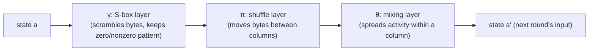
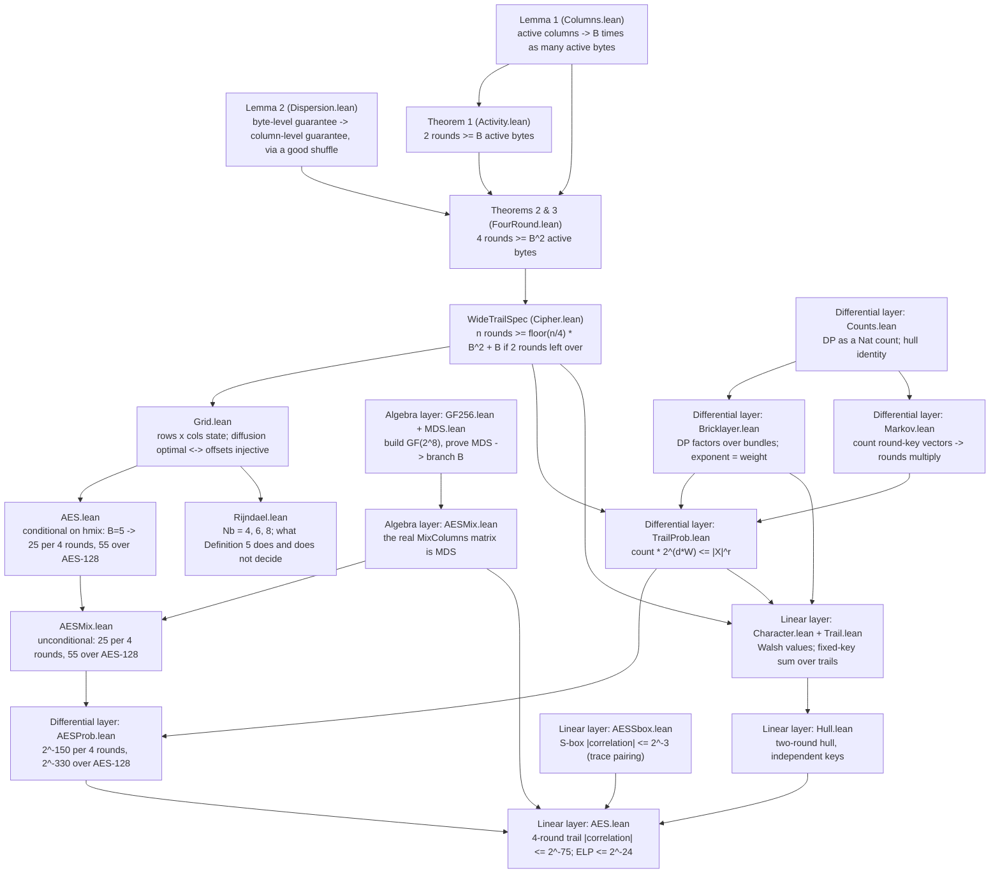
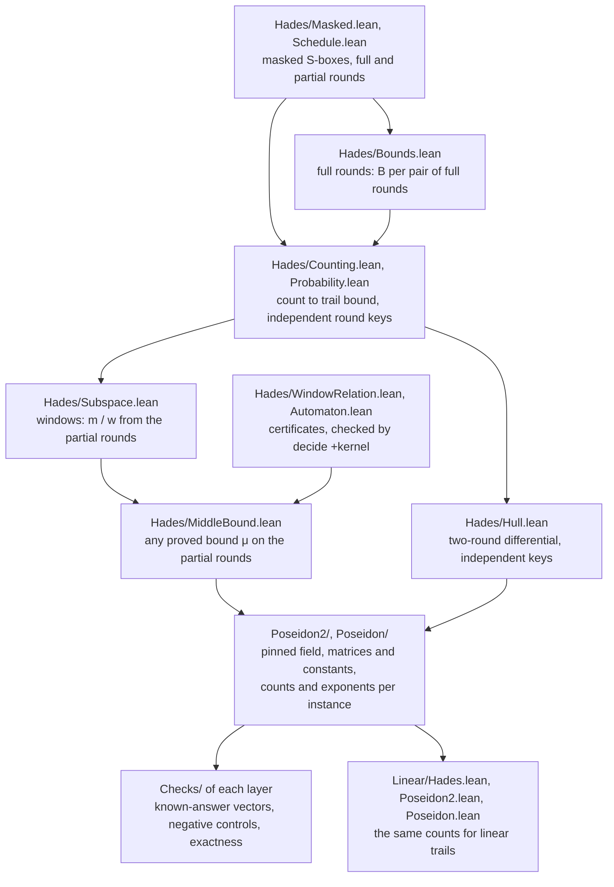

[WideTrail](../README.md) › [Documentation](README.md) › How it works

# How it works

The library turns a cipher's design into a few numbers, each a lower bound on the number of
S-boxes that every trail activates, and proves each bound in Lean.

## The shape of a round

An AES-like round has three steps: an S-box layer γ, a shuffle π and a mixing layer θ, one
after another. HADES partial rounds apply the S-box to one coordinate only.

γ keeps the pattern of nonzero positions, and π only moves positions. So θ is the only step
that changes how many positions are active, and its branch number bounds from below the active
positions at its input and output together. A lower bound for θ is therefore a lower bound for
the whole round.

## The AES proof chain

The files build the proof up in layers, each one feeding the next:

[`WideTrail/Propagation/Checks/`](../WideTrail/Propagation/Checks/),
[`WideTrail/Differential/Checks/`](../WideTrail/Differential/Checks/) and
[`WideTrail/Linear/Checks/`](../WideTrail/Linear/Checks/) sit beside this chain. They add no
theorem about the ciphers. They test the theorems above on small hand-built examples, measure
how tight the bounds are, and pin the axioms that the results depend on.

## The Poseidon2 and Poseidon proof chain

The HADES layer charges full and partial rounds separately. Each deployed instance then fixes
its field, matrices and constants and discharges every hypothesis. An arrow means that the
first box feeds the second.

- **Full rounds.** `outerRound_bound` charges `(r / 2 + s / 2) * B + r % 2 + s % 2` S-boxes for
  `r` full rounds before and `s` after the partial rounds, with `B` a branch number of the
  full-round linear layer.
- **Partial rounds.** Windows give `m / w` (`outer_middle_bound`). Window relations and
  forward-space automata give larger bounds for a concrete matrix; the kernel checks them by
  `decide +kernel`, and `MiddleBound` adds any such bound to the count.
- **Pinning.** The instance files fix the parameters of a pinned source, and the `Checks/`
  files reproduce the upstream known-answer vectors. See
  [PRODUCTION_CERTIFICATE.md](../PRODUCTION_CERTIFICATE.md).

## Why this is useful

Bounding what differential cryptanalysis can do against a cipher normally means checking or
searching large numbers of trails by hand or by program, one cipher at a time. This project
instead proves an activity bound that holds for a whole *family* of designs at once, AES
included, as long as the design has the wide-trail shape: an S-box layer, a mixing layer with
a known branch number, and a shuffle that spreads columns well. The differential layer turns
such counts into trail bounds, and bounds two-round differentials from the branch number
directly, in a model with independent round keys. The linear layer does the same for
correlations: the same activity counts bound the correlation of one linear trail, the cipher's
correlation under a fixed key is shown to be a sum over trails with key-dependent phases (signs
in the binary case), and a two-round linear hull is bounded in the independent-key model. Apart
from the toy ciphers of the checks, concrete linear trail and hull bounds are proved for AES
only, under the trace pairing; for the Poseidon and Poseidon2 instances only the linear
activity counts are unconditional (for Poseidon2, over the rounds after the initial external
layer), since no S-box correlation bound over a prime field is proved.

Two properties make the bounds useful:

- **Kernel-checked.** Lean's kernel, a small program, checks every proof step. If the project
  builds and the axiom audits pass, every theorem follows from its definitions with no
  unproved step. Whether a theorem says what you need depends on its statement and
  definitions. Read them, and see
  [What is proved and what is not](../README.md#what-is-proved-and-what-is-not).
- **Parametric.** The branch number, the state shape and the mixing layer are parameters. A
  new design with the same round structure needs only its own branch number and S-box facts
  proved; the counting argument is reused.

Activity counts become trail bounds once the S-box's differential uniformity is known, in the
model with an independent uniform key per round. A differential sums many trails, and fixed
public constants do not provide independent keys. `Differential/Hull.lean` and
`Hades/Hull.lean` bound a differential, the sum over all trails, but only over two full rounds
and only averaged over independent keys. Nothing here bounds a differential of a permutation
with fixed constants or under one fixed key.

Next: [LAYERS.md](LAYERS.md) for what each layer proves; then, for cryptographers,
[MECHANICS_HADES.md](../MECHANICS_HADES.md) and the other mechanics documents, and for zk
engineers, your instance in [PRODUCTION_CERTIFICATE.md](../PRODUCTION_CERTIFICATE.md).
